# 캠퍼스 가상 증권 거래소 설계 명세서
**Software Design Specification (SDS) — 1st Elaboration**

**기준 요구사항**: 요구사항 정의서 v1.2 (2026-10-27 변경 반영: VI ±20% 기준, 로컬 소형 언어 모델 기반 AI 게시글 생성 + 템플릿 폴백)
**작성일**: 2026년 11월 3일
**문서 범위**: SCR-01 ~ SCR-06 전체 + `[확장]` 항목 포함

본 문서는 '캠퍼스 가상 증권 거래소 v1.2'의 1차 Elaboration 단계 산출물인 소프트웨어 설계 명세서(SDS)입니다. 요구사항(Use Cases), UI 스토리보드, 시스템 아키텍처, 시퀀스 흐름, 클래스 구조, 데이터베이스 스키마 및 추적성 분석(Traceability Analysis)을 포함합니다.

**개정 이력**

| 판본 | 일자 | 내용 |
| :--- | :--- | :--- |
| v0.1 (초안) | 2026-11-03 | UC 5건, 시퀀스 1건, 상세 테이블 4건 |
| v1.0 | 2026-11-03 | 전 SCR(처리 흐름 절 단위) + 확장 범위 커버하도록 전면 보강 — UC 16건, 시퀀스 다이어그램 12건, 상세 테이블 16건, 추적성 매트릭스 확장 |
| v1.1 (본 판본) | 2026-11-03 | 관리자 백오피스(Admin Back-office)·Object Storage 아키텍처 반영, SD-01 멱등성 키·Redis 분산 락 방어 보강, SD-13~15 신설(백오피스 검토·공시 / 포트폴리오 집계 / 이자·배당 일괄 지급), Admin·AdContent 클래스 추가, 추적성 매트릭스 갱신 |

> 초안 UC→ 본 판본 UC 대응: 초안 UC-01→UC-01, UC-02→UC-03/UC-04, UC-03→UC-05, UC-04→UC-08/UC-09, UC-05→UC-14. 신설: UC-02(대시보드), UC-06/07(공매도), UC-10~12(AI·공시), UC-13(오락실), UC-15/16(이자·배당·입찰).

---

## 1. Use Cases (Refined)
시스템과 액터(Actor) 간의 상호작용 및 핵심 UC를 정의합니다.

### 1.1 액터 정의

| 액터 | 유형 | 설명 |
| :--- | :--- | :--- |
| **이용자 (User)** | 인간 액터 | `.ac.kr` 학교 이메일로 가입한 실사용자. 주문·커뮤니티·오락실·자산 관리 수행 |
| **신규 이용자** | 인간 액터 | 온보딩(이메일 인증 → 프로필 설정) 중인 미가입 사용자 |
| **운영자/관리자** | 인간 액터 | 공시 발행, 신고 콘텐츠 검토(유지/숨김/삭제), 게임·종목 정책 관리 |
| **AI 참여자** | 시스템 액터 | 서버가 구동하는 가상 시장 참여자. 실이용자와 **동일한 규칙**으로 주문·게시글·입찰에 참여 (UI에서 실유저와 구분 없음) |
| **매칭 엔진** | 시스템 액터 | 연속 경매(가격·시간 우선), VI 단일가 경매, 체결 처리 수행 |
| **LP (Liquidity Provider)** | 시스템 액터 | 사전 정의된 가격 기준·유동성 정책으로 호가 공급 (슬리피지 0.5% 이내) |
| **중앙은행** | 시스템 액터 | 기준금리·예수금 이자율 정책, 이자·배당 지급, 수수료·낙찰금 소각, 예금 계좌 관리 |
| **스케줄러** | 시스템 액터 | AI 게시글 발행(포아송), VI·담보 감시, 세션 만료, 입찰 마감, 자산 스냅샷 등 배경 작업 수행 |

### 1.2 UC 요약

| UC | 이름 | 주 액터 | 관련 SCR | 범위 |
| :--- | :--- | :--- | :--- | :--- |
| UC-01 | 회원가입·온보딩 및 초기 자산 지급 | 신규 이용자 | SCR-01 | MVP |
| UC-02 | 대시보드 실시간 시장 조회 | 이용자 | SCR-02 | MVP (부재 요약·전광판 배너는 확장) |
| UC-03 | 주문 접수 및 연속 경매 체결 | 이용자, AI 참여자 | SCR-03 §1~10 | MVP |
| UC-04 | 미체결 주문 조회·취소 | 이용자 | SCR-03 §6 | MVP |
| UC-05 | VI 발동 및 단일가 매매 | 매칭 엔진(시스템) | SCR-03 §11 | 확장 |
| UC-06 | 공매도 대차·상환 | 이용자 | SCR-03 §12, SCR-06 §9 | 확장 |
| UC-07 | 담보 유지비율 감시 및 강제 청산 | 중앙은행/스케줄러 | SCR-06 §10 | 확장 |
| UC-08 | 게시글 작성 및 포지션 인증 | 이용자 | SCR-04 §1~5 | MVP |
| UC-09 | 공감·정렬·신고 (피드 상호작용) | 이용자, 관리자 | SCR-04 §5, §12 | MVP |
| UC-10 | AI 참여자 정기 게시글 발행 | AI 참여자(시스템) | SCR-04 §6~8, §13 | MVP |
| UC-11 | 사용자 게시글 AI 지연 반응 | AI 참여자(시스템) | SCR-04 §9 | MVP |
| UC-12 | 공시 발행 및 알림 | 중앙은행/운영자 | SCR-04 §10~11 | MVP |
| UC-13 | 오락실 게임 플레이·보상 수령 | 이용자 | SCR-05 | 확장 |
| UC-14 | 포트폴리오·자산 현황 조회 | 이용자 | SCR-06 §1~7 | MVP |
| UC-15 | 이자·배당 지급 및 내역 조회 | 중앙은행(시스템), 이용자 | SCR-06 §11~12 | 확장 |
| UC-16 | 전광판 입찰·낙찰 | 이용자, AI 참여자 | SCR-06 §13~15 | 확장 |

### 1.3 상세 UC

#### UC-01: 회원가입·온보딩 및 초기 자산 지급 `[MVP]`
- **액터**: 신규 이용자
- **사전조건**: 미가입 상태. `.ac.kr` 학교 이메일 보유
- **트리거**: 가입 화면에서 인증번호 발송 요청
- **주 흐름**
  1. 이메일 입력 → 형식·`.ac.kr` 도메인 검증 → 기존 가입/잠금 상태 확인 → 6자리 인증번호 발급(유효 3분) → 이메일 발송 → `03:00` 카운트다운 시작
  2. 인증번호 입력 → 유효기간·잠금·일치 검증 → `VERIFIED` 전환 → 프로필 설정 단계 이동
  3. 닉네임(2~12자, 중복 즉시 인라인 검사)·비밀번호(정책)·초기 칭호(DB 관리 목록) 입력
  4. 가입 요청 → 서버 최종 검증(인증 상태·이메일/닉네임 중복·입력값)
  5. **단일 트랜잭션**: User + Profile(칭호) + Wallet + 중앙은행 예금 계좌 생성 → 초기 자산 1,000,000P 지급(사용자당 1회) → 지급 이력(Ledger) 기록 → `COMMIT` (실패 시 전체 `ROLLBACK`)
  6. 로그인 상태/토큰 발급, 가입 이전 시장 이벤트는 신규 알림에서 제외하도록 수신 기준 설정
  7. 완료 모달: `0 → 1,000,000P` 카운트업, 기준금리·예수금 이자율 칩, 종합지수 미니 차트("시장은 이미 움직이고 있습니다"), 브리핑 1줄 → 서비스 시작
- **예외 흐름**: `.ac.kr` 외 도메인(발송 차단) / 이미 가입된 이메일(가입 차단·로그인 안내) / 인증번호 불일치·만료(실패 +1, 재발송 유도) / 3회 오류(해당 이메일 5분 잠금) / 닉네임 중복·길이 오류(가입 차단) / 트랜잭션 실패(전체 롤백) / 시장 데이터 조회 실패(**가입은 성공 유지**, 브리핑만 안내) / 초기 지급 중복 요청(최초 1회만)
- **사후조건**: 계정·지갑·예금 계좌 존재, 초기 자산 지급 완료(1회), 세션 활성
- **연관**: SCR-01 §1~6

#### UC-02: 대시보드 실시간 시장 조회 `[MVP]`
- **액터**: 이용자
- **사전조건**: 로그인 상태
- **트리거**: 메인 대시보드 진입
- **주 흐름**
  1. 초기 데이터 조회(REST): 종합지수, 종목 시세 스냅샷, 랭킹, 공시 목록, 중앙은행 정책(금리·LP 가동 상태) + 각 최종 갱신 시각
  2. WebSocket 구독 시작 → 지수·종목 시세(현재가·등락률·거래량·거래 상태) 수신 → 버전/갱신 시각 비교 후 최신만 반영
  3. 카테고리 탭(전체/학과주/학사일정 테마/교내 밈 코인)·정렬 기준 선택 → 1초 단위 랭킹 스냅샷 → 순위 변동 시 재배치 애니메이션
  4. 종목 상태 배지(`일반 매매`/`단일가 매매`/`VI 발동 중`/`배당락 D-Day`) 표시
  5. 등락률 상위 5개 종목에 변동 사유 태그(`공시`/`이벤트`/`참여자 급증`) 부착 — 근거 없는 임의 사유는 생성하지 않음
  6. GNB 하단 중앙은행 정책 칩 상시 노출, 공시 배너 표시
  7. 우측 플로팅 위젯: 보유 잔액·포지션 평가손익·금일 누적 이자 표시, 체결·이자 지급 시 갱신
- **대안 흐름**: WS 끊김 → **5초 간격 HTTP 폴링** 자동 전환 → 재연결 성공 시 스냅샷 재조회로 누락 보정 후 폴링 중단
- **확장 흐름**: 부재 중 시장 변동 요약 배지(마지막 접속 시각 기준, 데이터 부족 시 미표시) / 캠퍼스 전광판 배너(AI 입찰 경쟁 결과, 유효 배너 없으면 기본 안내)
- **예외 흐름**: 시세 조회 실패(스켈레톤 UI + 재시도, 이전 스냅샷 유지) / 부재 요약 계산 불가(배지 숨김, 에러 노출 안 함) / 자산 조회 실패(잘못된 금액 미표시, 재조회 안내)
- **사후조건**: 실시간 구독 유지, 이번 접속 시각 기록(다음 부재 요약 기준)
- **연관**: SCR-02 §1~8

#### UC-03: 주문 접수 및 연속 경매 체결 `[MVP]`
- **액터**: 이용자, AI 참여자 (동일 규칙 적용)
- **사전조건**: 로그인 상태, 종목이 `일반 매매` 상태
- **트리거**: 거래 화면에서 매수/매도 주문 제출
- **주 흐름**
  1. 거래 화면 진입: 종목 기본 정보·시세·호가 상하 10단계·최근 체결·차트 + 사용자 사용 가능 예수금/예약 예수금/매도 가능 수량 조회 → WS 구독
  2. 실시간 갱신: 주문 등록·취소·체결에 따른 오더북 잔량 갱신, 잔량 막대 비례 표시, LP 물량 `LP` 아이콘 구분(AI 주문은 구분 없음), 체결 테이프 상단 추가
  3. 주문 유형(매수/매도)·거래 방식(지정가/시장가) 선택, 지정가는 호가창 클릭으로 가격 지정 가능, 수량 입력 또는 비율 퀵 버튼(10/25/50/MAX)
  4. 예상 거래 금액·수수료(0.1%)·예상 정산액 실시간 계산, 시장가는 추정 금액 + 오차 가능성 안내
  5. 주문 제출(중복 요청 방지 식별자 포함) → 서버 검증: 로그인·거래 권한 / 종목 거래 가능 상태 / 유형·방식 조합 / 호가 단위·가격 범위 / 수량 제한 / 예수금(금액+수수료) 또는 매도 가능 수량(미체결 매도 묶임 제외)
  6. 검증 통과 → 필요 예수금/수량 **예약** → 고유 주문 ID 생성·기록 → 종목별 매칭 큐 등록 (동일 식별자 재전송 시 기존 결과 반환)
  7. **매칭**: 종목별 처리 순서 보장 → 반대편 오더북 탐색(매수는 최저 매도부터, 매도는 최고 매수부터) → 지정가는 가격 조건 충족 시, 시장가는 최우선 호가부터 → **가격 우선·시간 우선** → 체결량 = min(양측 잔량) → 잔량 소진 시까지 순차 체결
  8. **정산**: 체결금액 = 가격 × 수량, 수수료 0.1% 양측 부과, 매수자 예약금 정산·보유 증가, 매도자 수량 차감·대금 입금, 초과 예약 해제 → 체결·잔고 변동 Ledger 기록 (**정산+상태 변경+원장 기록 원자성**, 체결 ID 기준 중복 처리 방지)
  9. **결과 전달**: WS로 호가창·현재가·거래량·체결 테이프 갱신 브로드캐스트, 주문자에게 체결 수량·평균가·수수료·잔량·주문 상태 전달 → 잔고·평가손익 갱신
  10. 차트: 캔들/선 토글, 1분/5분/일봉, 공시·이벤트 발생 시각 마커(클릭 시 요약 표시)
- **대안 흐름**: 부분 체결 → 지정가 잔량 오더북 등록(`PARTIALLY_FILLED`), 시장가 잔량은 정책에 따라 취소 / 일반 호가 부족 → LP 유동성 공급(허용 슬리피지 0.5% 이내 검증, 초과 시 무조건 체결하지 않고 잔량 정책 적용), LP 체결도 동일 정산·원장 기록
- **예외 흐름**: 예수금 부족(주문 거부+잔액 안내) / 호가 단위·수량 위반(거부+단위 안내) / VI 중 연속 경매 주문(접수 불가, 단일가 접수 유도 → UC-05) / 서버 장애 중 주문(접수 거부, 오더북 원자성 보장) / 이벤트 전달 실패(확정 체결·정산 데이터 유지, 재접속 시 서버 확정 데이터로 동기화)
- **사후조건**: 주문·체결·Ledger 기록 일치, 잔고·오더북 최신 상태
- **연관**: SCR-03 §1~10

#### UC-04: 미체결 주문 조회·취소 `[MVP]`
- **액터**: 이용자
- **사전조건**: 미체결 주문 존재
- **주 흐름**: 미체결 목록 조회(가격·수량·체결량·잔량) → 취소 요청 → 서버가 주문 상태·취소 가능 잔량 확인 → 오더북에서 잔량 제거·`CANCELED` 처리 → 예약 예수금/수량 해제 → 결과 알림
- **예외 흐름**: 취소와 체결 동시 발생(서버 확정 처리 순서 따름) / 거래일 종료 시 당일 잔여 지정가 자동 취소(`EXPIRED`)·예약 해제·알림
- **사후조건**: 주문 상태 확정, 예약 자원 해제
- **연관**: SCR-03 §6

#### UC-05: VI 발동 및 단일가 매매 `[확장]`
- **액터**: 매칭 엔진(시스템), 이용자(단일가 주문 접수)
- **트리거**: 종목별 최근 5분간 가격이 기준 가격 대비 **±20%** 도달
- **주 흐름**
  1. 변동률 지속 계산 → 발동 판정 → 종목 상태 `VI_ACTIVE` 전환·연속 경매 체결 중단
  2. VI 발동·종료 예정 시각 기록 → **2분간 단일가 주문 접수** 시작
  3. 클라이언트: 호가창 상단 오버레이("VI 발동 — 2분간 단일가 매매"), 잔량 타워 → 접수 물량 누적 그래프 전환
  4. VI 기간 주문 검증: 단일가 매매 허용 방식만 접수(연속 경매 방식 거부), 즉시 체결 없이 경매에 접수
  5. 접수 종료 → 가격별 예상 체결 수량 계산 → 사전 정의 규칙(최대 체결 수량)으로 **단일 체결 가격(Clearing Price)** 결정 → 체결 가능 주문 일괄 매칭
  6. 정산·Ledger 기록(원자성) → 거래 상태 정상 복귀 → 정상 호가창·실시간 연속 경매 데이터 재개
- **예외 흐름**: VI 기간 중 연속 경매 주문(접수 불가 안내) / 미체결 주문은 종료 후 주문 유지·취소 정책에 따름
- **사후조건**: 일괄 체결·원장 확정, 거래 상태 정상화
- **연관**: SCR-03 §11

#### UC-06: 공매도 대차·상환 `[확장]`
- **액터**: 이용자
- **사전조건**: 공매도 기능 활성화, 종목 공매도 허용
- **주 흐름**
  1. 공매도 탭에서 종목·수량 선택 → 대차 가능 수량·대차 수수료율(일 0.05%)·필요 담보·담보 유지비율(120%)·예상 청산 가격 조회·표시(경고 라인)
  2. 주문 제출 → 대차 가능 수량·담보 충족 검증 → 주식 대차 처리·담보 자산 예약
  3. 매도 주문으로 일반 매칭 규칙(가격·시간 우선) 적용 → 체결 시 공매도 포지션·대차 잔여 수량 기록, 매도 대금 정산 정책 관리
  4. 포지션 평가금액·대차 수수료·담보 유지비율 지속 갱신
  5. 상환 요청 → 대상 포지션·수량 검증 → 보유 주식 사용 또는 매수 주문 생성(일반 매칭, 유동성 부족 시 부분 체결/LP) → **실제 확보 수량만큼만** 상환 확정 → 담보 해제·대차/정산 이력 Ledger 기록 → 전량 상환 시 포지션 종료
- **예외 흐름**: 담보 유지비율 < 120%(경고 표시 → 미달 지속 시 UC-07 강제 청산)
- **사후조건**: 포지션·담보·Ledger 일치
- **연관**: SCR-03 §12, SCR-06 §9

#### UC-07: 담보 유지비율 감시 및 강제 청산 `[확장]`
- **액터**: 중앙은행/스케줄러(시스템), 이용자(담보 보충·상환)
- **트리거**: 주기적 감시 중 담보 유지비율 120% 미만 하락
- **주 흐름**
  1. 활성 공매도 포지션의 유지비율 주기 재계산(가격·담보 평가 변동 반영)
  2. 120% 미만 → 담보 부족 상태 전환·발생 시각/유지비율 기록 → 경고 알림 + 마이페이지 경고 배지
  3. 허용시간 내 담보 보충 또는 일부 상환 → 유지비율 재계산(회복 시 정상 상태)
  4. 허용시간 종료까지 미달 → 강제 청산 대상 확정(중복 청산 방지 상태 설정)
  5. 청산 대상 수량 계산 → 매칭 엔진 청산 주문 제출(부분 체결/LP 백스톱 허용) → **실제 체결 수량만** 포지션·담보 정산 → 청산 거래·수수료·손익·담보 변동 Ledger 기록 → 미청산 잔량은 청산 진행 상태 유지·재시도 → 완료 시 사용자 알림
- **사후조건**: 포지션 정산·담보 변동 확정, 알림 전달
- **연관**: SCR-06 §10

#### UC-08: 게시글 작성 및 포지션 인증 `[MVP]`
- **액터**: 이용자
- **사전조건**: 로그인 상태, 종목 채널 진입
- **주 흐름**
  1. 채널 진입: 사용자 게시글 + AI 참여자 게시글 + 공시 카드를 하나의 피드로 조회(작성자·칭호·뱃지·본문·태그·시각·공감 수), 정렬(실시간/인기)·페이지 단위 반환 → WS 구독(신규 글·공감·공시), 채널 이동 시 재구독
  2. 태그 선택(`🚀 떡상각`/`📉 떡락각·공매도`/`👀 관망`) + 본문 작성(≤500자, 초과 시 등록 버튼 비활성화)
  3. 등록 요청 → 서버 검증(권한·태그 유효성·길이·공백·금칙어)
  4. **포지션 인증**: `떡상각`→실제 보유 수량 확인, `떡락각·공매도`→유효 공매도 포지션 확인, `관망`→미부착. 일치 시 인증 뱃지 부착(인증 결과·기준 시각 기록), 미일치·조회 실패 시 **등록은 허용하되 뱃지 없음**
  5. 저장 → WS 신규 게시글 이벤트 → 피드 정렬 기준에 따라 삽입 → `새 글` 하이라이트 + 설정된 시간 동안 AI 글보다 상단 우선 노출 → 종료 후 정렬 기준 재적용
- **예외 흐름**: 500자 초과(등록 거부) / WS 끊김(재연결 후 마지막 이벤트 이후 게시글 보정) / 중복 이벤트(게시글 ID 기준 1회만 표시) / 발행 이벤트 실패(저장된 글 유지, 이후 조회로 확인)
- **사후조건**: 게시글 저장·피드 반영, 인증 결과 기록
- **연관**: SCR-04 §1~4

#### UC-09: 공감·정렬·신고 (피드 상호작용) `[MVP]`
- **액터**: 이용자, 관리자
- **주 흐름**
  1. 공감 요청 → 중복 공감 이력 확인 → 신규 공감 생성/취소(원자성) → 공감 수 갱신 → WS 공감 수 이벤트 → 버튼 상태·수 갱신
  2. 정렬: `실시간`(최신순) / `인기`(공감 수 내림차순, 동률 시 최신 우선)
  3. 신고: 신고 대상·사유 전달 → 존재·신고 가능 여부 확인 → 이력 저장(동일 사용자 중복 제한) → 정책 기반 검토 대상 분류 → 명백한 위반 시 숨김 가능 → 관리자 검토(유지/숨김/삭제) → 숨김·삭제 콘텐츠는 피드에서 제외 → 상태 변경 이벤트 전달
  4. **AI 참여자 게시글에도 동일한 콘텐츠 관리 기준 적용**
- **예외 흐름**: 동시 공감 요청(원자성 보장) / 신고 처리 실패(원본 데이터 임의 변경 없음)
- **연관**: SCR-04 §5, §12

#### UC-10: AI 참여자 정기 게시글 발행 `[MVP]`
- **액터**: AI 참여자(시스템 — 스케줄러·AI 생성 서비스)
- **트리거**: 종목별 발행 스케줄 도래(포아송 프로세스, 종목당 시간당 5~15건)
- **주 흐름**
  1. 스케줄러가 발행 작업 등록(다중 서버 중복 실행 방지 장치 적용)
  2. 참여 가능 AI 선정: 활성 상태·최근 작성 시각·발행 제한 조건 확인
  3. 상태 수집: 실제 보유 종목·수량·평균 매입가·평가손익·거래 상태
  4. **상황 코드 결정**: `HOLD_PROFIT`/`HOLD_LOSS`/`HOLD_NEUTRAL`(보유+손익), `WATCH_BUY`/`WATCH_NEUTRAL`(미보유), `SHORT_POSITION`(유효 공매도). 데이터 부족 시 단정적 표현 금지·중립 코드 대체
  5. **로컬 모델 생성**: 외부 유료 API 없이 서비스 관리 로컬 추론 환경(1차 후보 `Ollama + Qwen3 1.7B`, 속도·메모리 측정 후 확정)에서 생성. 커뮤니티 서버 → AI 생성 모듈(RESTful API) 제한시간 내부 API 요청. 모델에는 종목명·가격·등락률·실제 보유 상태·페르소나·상황 코드만 전달(개인정보·인증 정보·타인 계좌 미전달)
  6. **교차 검증**: 모델 출력 수치·보유 사실은 신뢰하지 않고 서버 원본 데이터와 교차 검증. 500자 이하·금칙어·보유 상태 일치·최근 글과의 중복/유사도 검사. 허위 보유·모순·부적절 내용은 폐기 후 제한 횟수 재생성
  7. 발행: 작성자 유형 `AI_PARTICIPANT`, 모델 식별자/버전, 생성 방식(`LOCAL_MODEL`/`TEMPLATE`), 검증 결과, 생성 시각 기록 → 사용자 게시글과 동일한 피드 발행 과정 → **AI 라벨·배지·아이콘 미표시**(일반 참여자와 동일 카드 UI)
  8. 운영 지표 기록: 실행 횟수·평균 생성 시간·성공률·검증 탈락률·템플릿 폴백 비율·CPU/메모리 점유율
- **대안 흐름 (템플릿 폴백)**: 모델 타임아웃·메모리 부족·생성 실패 시 → `templates[페르소나][상황코드]` 무작위 선택 → 종목명·가격 변동률·평가손익 반영 → 보유 상태 모순 검사(미보유 종목 보유 주장/손익 반전/허위 공매도 발행 금지) → 500자·금칙어 위반 시 다른 템플릿 → **동일 템플릿 24시간 내 3회 이상 사용 시 제외** → 검증 통과 시 발행, 가용 템플릿 없으면 스킵(다음 스케줄 재시도)
- **예외 흐름**: 발행 실패(실패 이력 기록·재시도 정책) / 스케줄러 오류(사용자 게시글 작성·조회·주문 처리에 영향 없음) / 모델 응답 지연(비동기 처리로 피드 조회·작성·주문 처리 무영향) — 모델 재학습 없이 서비스 운영·시연 가능
- **사후조건**: AI 게시글 저장·발행, 생성 메타데이터·지표 기록
- **연관**: SCR-04 §6~8, §13

#### UC-11: 사용자 게시글 AI 지연 반응 `[MVP]`
- **액터**: AI 참여자(시스템 — 백그라운드 큐)
- **트리거**: 사용자 게시글 정상 저장
- **주 흐름**
  1. 반응 생성 작업 백그라운드 큐 등록(원본 글과 비동기)
  2. 게시글 본문 분석 → 사전 등록된 종목명·별칭 사전과 비교 → 종목 ID 추출
  3. 추출 종목 관련 포지션 보유 AI 참여자 조회 → **0~3명 무작위 선정**
  4. 선정 AI마다 **30초~10분 반응 지연시간** 설정 → 지연 후 게시글 삭제 여부·AI 상태 재확인
  5. 페르소나·포지션 기반 반응 유형 결정 → 공감 수행 또는 사전 정의 반응 템플릿으로 댓글 생성
  6. 금칙어·포지션 모순 검증 통과 시에만 저장 → WS 댓글/공감 갱신 이벤트
  7. 동일 AI의 동일 게시글 중복 반응 방지(반응 이력 관리)
- **예외 흐름**: 종목명 미확인·참여 가능 AI 없음(작업 종료 — 정상 동작) / 처리 실패(원본 사용자 게시글 유지)
- **연관**: SCR-04 §9

#### UC-12: 공시 발행 및 알림 `[MVP]`
- **액터**: 중앙은행/운영자(발행 주체), 이용자(수신)
- **트리거**: 통화정책 변경·배당·소각·종목 이벤트 발생
- **주 흐름**
  1. 공시 등록(제목·대상 종목·유형·본문·적용 시각) → 발행 권한·필수 항목 검증 → 공시 ID·발행 주체·시각 저장
  2. 유형·종목에 따른 영향 태그 결정(`배당`/`소각`/`이벤트`/`통화정책`)
  3. 특정 종목 연결 시 해당 종목 커뮤니티에 공시 카드 생성, 다종목 공시는 종목별 조회 가능하도록 연결 정보 기록
  4. 관련 종목 채널에 WS 공시 이벤트 → 일반 게시글과 구분된 카드 표시 → 클릭 시 공시 상세 이동
  5. 알림: 대상 선정(관심 등록·수신 조건 충족, 개인 관련 이벤트는 게시글 작성자) → **가입 이전 이벤트 제외** → 알림 기록 → WS 온라인 사용자 전달 → 미확인 알림 수 갱신 → 선택 시 관련 상세 이동
- **예외 흐름**: 공시 중복 전달(공시 ID 기준 카드 중복 생성 없음) / WS 알림 실패(저장된 알림 유지, 이후 목록 조회로 확인) / 동일 이벤트 중복 알림 방지
- **연관**: SCR-04 §10~11

#### UC-13: 오락실 게임 플레이·보상 수령 `[확장]`
- **액터**: 이용자
- **사전조건**: 로그인 상태, 게임 이용 가능
- **주 흐름**
  1. 오락실 진입: 게임 목록(ID·이름·설명·썸네일·상태·보상 정책) + 당일 누적 획득량·일일 한도 → 잔여 획득 가능 포인트 계산 → 썸네일 그리드 + 한도 게이지 표시
  2. 게임 선택 → 존재·이용 상태·제한 조건 검증 → 플레이 세션 생성(고유 ID·시작 시각·상태·검증 정보) → 게임 화면 실행(팝업/전체화면)
  3. 플레이 진행: 게임별 진행 데이터 수집·서버 검증 가능 정보 유지, 점수·진행 상태·남은 시간 표시
  4. 완료 시 결과 데이터 + 세션 ID 제출 → 서버 검증: 세션 소유자·정상 시작·제출 가능 상태·만료 여부·중복 처리 여부 → **클라이언트 최종 점수는 신뢰하지 않고** 게임별 검증 모듈이 점수 검증/산출 → 비정상·불가능·위변조 의심 시 거부
  5. 보상 계산: 게임별 정책(최소·최대 제한·추가 조건)으로 기본 포인트 산출·조정
  6. **일일 한도 검증**: 당일 누적 + 지급 예정 비교 → 초과 시 잔여 한도만큼 조정, 한도 도달 시 0 → 동시 보상 요청 동시성 제어
  7. **지급 트랜잭션(원자성)**: BEGIN → 동일 세션 지급 이력 확인(존재 시 기존 결과 반환) → 트랜잭션 내 한도 재확인 → 중앙은행 예금 계좌 입금 → 일일 누적 갱신 → Ledger 기록 → 세션 `SETTLED` → COMMIT (실패 시 전체 ROLLBACK) → 동일 세션 ID 재요청 시 1회만 지급 보장, 한도 초과 0 지급도 사유 기록
  8. 결과 팝업: 점수·획득 포인트 → 지급 애니메이션 → 중앙은행 입금 표시 → 갱신 잔액·한도 게이지 반영
  9. 플레이·보상 이력 조회(게임 정보·시각·검증 점수·지급 포인트·상태, Ledger 연결, 거부 사유 표시)
- **예외 흐름**: 일일 한도 초과(지급 중단·게이지 안내) / 점수 위변조(서버 검증 실패 시 미지급) / 중복 지급 요청(Ledger·세션 ID 기반 차단) / 중도 종료·세션 만료(`ABANDONED`/`EXPIRED`, 미지급) / 통신 오류(동일 세션 ID로 안전한 재요청) / 결과 표시 실패(서버 확정 지급 결과 유지)
- **사후조건**: 세션 정산 완료, 예수금·한도·Ledger 일치
- **연관**: SCR-05 §1~10

#### UC-14: 포트폴리오·자산 현황 조회 `[MVP]`
- **액터**: 이용자
- **주 흐름**
  1. 마이페이지 진입: 프로필·자산 요약·보유 종목·미체결 주문 조회(일부 실패 시 정상 영역 표시 + 실패 영역 재시도)
  2. **총 평가 자산 집계**: Wallet 잔액(사용 가능/예약 구분) + 은행 계좌 + 보유 종목 평가금액(최신 시세 기준, 갱신 시각 포함) + 공매도 부채 반영(활성 시) — 예약·담보·이체 중복 합산 방지, 확정 정책 기준 산출
  3. 보유 종목 테이블: 종목·수량·평균 매입가·현재가·평가금액·평가손익(`(현재가-평균가)×수량`)·수익률, 정렬 가능, 종목 선택 시 거래 화면 이동
  4. 실시간 갱신: 보유 종목 WS 구독 → 시세 버전 확인 후 재평가, 체결 시 서버 확정 데이터 재조회로 동기화(시세 이벤트만으로 확정 잔고 임의 변경 금지)
  5. 자산 구성 도넛 차트 + 일별 총자산 추이 꺾은선(기록된 스냅샷 기준 — 과거 데이터 부재 시 임의 생성 없음, 현재 시세로 과거 재평가 없음)
  6. 예수금·거래 내역: 계좌별 잔액 구분, 체결 내역·자산 변동 이력(거래 ID 기준, 유형·기간 필터) — 확정 Ledger 기반, 사용자 수정 불가
- **예외 흐름**: 자산 조회 실패(이전 스냅샷 + 재시도, 오류 영역 구분 표시) / 확정 잔고 조회 실패(마지막 조회 값을 최신 확정으로 표시하지 않음) / 시세 조회 실패(이전 정상 스냅샷 + 기준 시각 표시) / 복구 시 전체 스냅샷 재조회로 일관성 확보
- **연관**: SCR-06 §1~7, §16

#### UC-15: 이자·배당 지급 및 내역 조회 `[확장]`
- **액터**: 중앙은행(시스템 — 스케줄러), 이용자
- **주 흐름**
  1. 중앙은행 스케줄에 따라 예수금 이자 지급: 기준 잔액·적용 금리(정책 테이블)로 계산 → 예금 계좌 입금 → Ledger 기록
  2. 배당 지급: 배당 기준일 확정 보유 수량 × 주당 배당금 → 입금 → Ledger 기록, 배당락 D-Day 배지로 사전 안내
  3. 이자 내역 조회: 지급일·계산 대상 잔액·적용 금리·지급 금액(테이블 표시, 선택 시 계산 기준·금리 정보) + 누적/기간 합계
  4. 배당 내역 조회: 종목·기준일·지급일·기준 수량·지급 포인트 + 누계, 내역 선택 시 관련 배당 공시 상세 이동
- **예외 흐름**: 내역 없음(안내 표시) / 조회 실패(다른 자산 기능은 정상 제공)
- **사후조건**: 지급 기록은 서버 확정 Ledger 기반, 클라이언트 수정 불가
- **연관**: SCR-06 §11~12

#### UC-16: 전광판 입찰·낙찰 `[확장]`
- **액터**: 이용자, AI 참여자
- **주 흐름**
  1. 입찰 현황 조회: 슬롯 정보(시작·종료·입찰 마감 시각·최소 입찰금) + 현재 최고가(AI 참여자 포함 전체 유효 입찰 기준) + 사용자 기존 입찰·낙찰 가능 상태 → 변경 시 WS 실시간 갱신
  2. 입찰 제출: 슬롯·금액·광고 콘텐츠 + 중복 요청 방지 식별자 → 검증(로그인·참여 권한 / 슬롯 유효·마감 전 / 최소 금액·입찰 단위 / 콘텐츠 등록·노출 정책 / 사용 가능 예수금) → **입찰 기록 + 예수금 예약(원자성)** → 최고가 갱신 → WS 이벤트
  3. 마감: 슬롯 마감 상태 전환 → 유효 입찰 조회 → **최고 금액 낙찰(동률 시 선접수 우선)** → 낙찰자 정산(예약금 최종 차감, 낙찰금 소각 Ledger 기록) → 비낙찰자 예약 해제 → 상태 갱신(중복 실행 방지) → 광고 콘텐츠-슬롯 연결 → 참여자별 결과 알림 → 마이페이지 입찰 이력 표시
- **예외 흐름**: 중복 입찰 요청(기존 결과 반환, 예수금 중복 예약 방지) / 입찰 실패(예약 잔액 남지 않도록 처리) / 정산 장애(확정된 입찰·지급 상태 확인으로 중복 차감·환불 방지) / 종료된 슬롯(신규 입찰 불허)
- **사후조건**: 낙찰·정산·소각 기록 확정, 광고 노출 연결
- **연관**: SCR-06 §13~15

---

## 2. UI / Storyboard
사용자가 경험하게 될 핵심 화면의 구성 요소와 흐름입니다.

### 2.1 화면 목록

| 화면 | 이름 | 핵심 구성 | 연결 UC |
| :--- | :--- | :--- | :--- |
| S-01 | Login & Onboarding | 3단계 가입 마법사, 완료 모달 | UC-01 |
| S-02 | Main Dashboard | GNB·정책칩, 지수 카드, 종목 랭킹, 공시 배너, 자산 위젯 | UC-02, UC-12 |
| S-03 | Trading & Orderbook | 차트, 10단계 호가창, 체결 테이프, 주문 패널, VI 오버레이 | UC-03~06 |
| S-04 | Community Feed | 종목별 피드, 공시 카드, 글 작성기 | UC-08~12 |
| S-05 | Campus Arcade | 게임 그리드, 한도 게이지, 결과 팝업 | UC-13 |
| S-06 | MyPage | 자산 요약, 차트 2종, 보유 종목/내역 테이블, 입찰 섹션 | UC-06, 07, 14~16 |
| S-07 | Notifications | 알림 아이콘·미확인 수·목록 | UC-12 |

### 2.2 화면별 상세

**1. Login & Onboarding Screen (S-01)**
* **View**: ① 이메일 입력 + `03:00` 카운트다운 타이머(만료 시 재발송 버튼 강조) ② 프로필 설정(닉네임 인라인 중복 검사 결과 즉시 표시, 비밀번호, 초기 칭호 선택) ③ 완료 모달.
* **Action**: 인증번호 재발송(기존 번호 무효화), 가입 완료.
* **완료 모달**: 자산 `0 → 1,000,000P` 카운트업 애니메이션, 현재 기준금리·예수금 이자율 칩(하드코딩 금지 — 서버 조회), 종합지수 미니 차트("시장은 이미 움직이고 있습니다"), 브리핑 1줄. 시장 데이터 조회 실패 시에도 가입 상태 유지 + 안내 메시지.

**2. Main Dashboard (S-02)**
* **GNB**: 상단 내비게이션 + 하단 **중앙은행 정책 칩** 상시 노출(기준금리·LP 가동 상태).
* **Main**: 전체 시장 종합지수 카드(값·당일 변동률·미니 차트), 카테고리 탭(전체/학과주/학사일정 테마/교내 밈 코인)별 종목 랭킹 — 순위·현재가·등락률·거래량·스파크라인·상태 배지(`일반 매매`/`단일가 매매`/`VI 발동 중`/`배당락 D-Day`)·변동 사유 태그.
* **랭킹 애니메이션**: 순위 변동 시 재배치 애니메이션(1초 단위 스냅샷).
* **우측 플로팅 위젯**: 보유 잔액·포지션 손익·금일 이자 누적.
* `[확장]` 부재 중 시장 변동 배지, 캠퍼스 전광판 배너 영역(AI 입찰 경쟁 결과 노출, 유효 배너 없으면 기본 안내).
* **연결 흐름**: WS 끊김 시 5초 폴링 자동 전환 → 재연결 시 스냅샷 보정.

**3. Trading & Orderbook (S-03)**
* **View**: 좌측 캔들/선 차트(1분/5분/일봉 토글, 공시·이벤트 발생 시각 마커 → 클릭 시 요약), 중앙 **상하 10단계 오더북**(잔량 비례 막대, 빈 호가 구간 LP 물량 `LP` 아이콘 구분), 체결 테이프(가격·수량·시각 실시간 스크롤).
* **Action**: 우측 주문 패널 — 주문 유형(매수/매도), 거래 방식(지정가/시장가), 호가창 클릭으로 가격 지정, 수량 입력·비율 퀵 버튼(10/25/50/MAX), 예상 정산액·수수료(0.1%) 실시간 계산 후 주문. 미체결 주문 목록 + 취소 버튼.
* **AI 참여자 주문은 실유저와 동일 표시** (익명성 — 구분 아이콘 없음).
* **VI 오버레이** `[확장]`: 호가창 위 "VI 발동 — 2분간 단일가 매매" 안내, 잔량 타워 → 단일가 접수 물량 누적 그래프로 전환, 종료 후 정상 복귀.
* **공매도 탭** `[확장]`: 대차 수수료율·담보 계산액 실시간 표시, 예상 청산 가격 경고 라인.

**4. Community Feed (S-04)**
* **View**: 종목별 채널 피드 — 게시글 카드(작성자·칭호·인증 뱃지·본문·태그·시각·공감 수). **로컬 모델/템플릿 생성 AI 게시글은 일반 참여자와 동일한 카드 UI(AI 라벨·배지·아이콘 미표시)**, 공시 카드는 별도 디자인으로 구분.
* **Action**: 글 작성(태그 3종 선택, 500자 카운터 → 초과 시 등록 비활성화), 공감 토글, 신고. 정렬 탭 `실시간`/`인기`.
* **피드백**: 실유저 신규 글 `새 글` 하이라이트 + 유저 글 상단 우선 노출 시간 창, 태그-포지션 일치 시 `실보유 인증`/`공매도 인증` 뱃지, 공시 카드 클릭 → 공시 상세.

**5. Campus Arcade (S-05)** `[확장]`
* **View**: 게임 라인업 썸네일 그리드(이름·설명·이용 상태), **일일 획득 한도 게이지 상시 노출**.
* **Action**: 게임 선택 → 플레이 화면(팝업/전체 화면, 게임별 조작).
* **결과 팝업**: 점수 집계 → 획득 포인트 지급 애니메이션 → 중앙은행 예금 입금 표시 → 갱신 잔액·한도 게이지. 한도 도달 시 추가 보상 불가 안내.

**6. MyPage (S-06)**
* **View**: 총 평가 자산 카드(전일 대비 변동 금액·변동률, 평가 기준 시각), 자산 구성 **도넛 차트**, 일별 총자산 추이 **꺾은선**(스냅샷 없는 구간은 빈 상태), 보유 종목 테이블(정렬, 종목 클릭 → 거래 화면), 예수금·거래 내역(유형·기간 필터).
* `[확장]` **공매도 탭**: 종목별 수량·진입가·현재가·평가손익·담보 유지비율, 120% 미만 경고 배지, `[청산/상환]` 버튼.
* `[확장]` **이자/배당 내역 탭**: 날짜·대상 잔액·적용 금리·지급액(조작 불가능한 서버 기록), 배당 내역 → 공시 상세 연결.
* `[확장]` **전광판 입찰 섹션**: 다음 슬롯 정보·현재 최고가(AI 참여자 입찰로 계속 갱신)·남은 시간.

**7. Notifications (S-07)**
* **View**: 상단 알림 아이콘 + 미확인 수 배지, 알림 목록(유형·시각).
* **Action**: 알림 선택 → 관련 게시글/공시/입찰 결과 상세 이동. 가입 이전 이벤트는 미포함.

### 2.3 화면 이동 흐름 (Screen Flow)

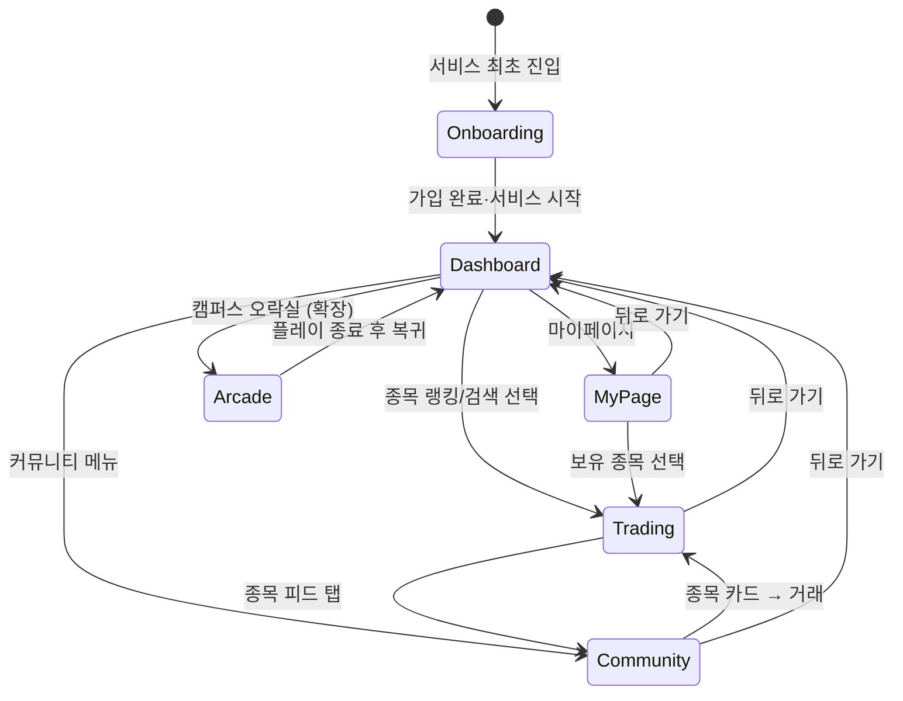

### 2.4 주요 상태 전이 (UI 피드백 기반)

**주문 상태**

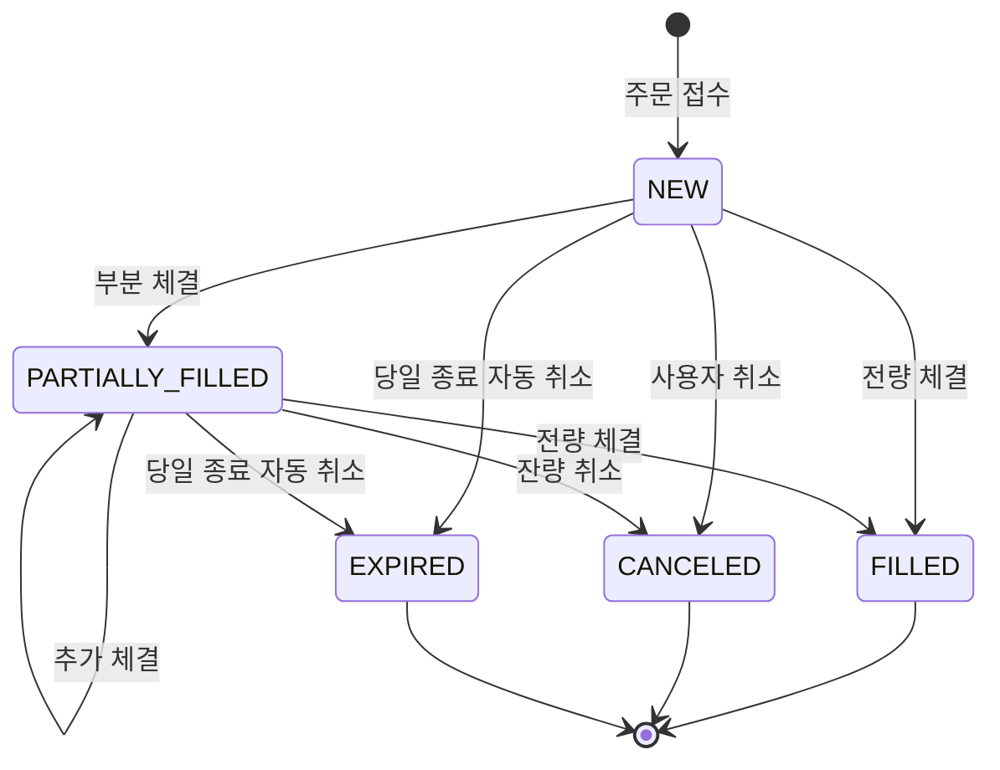

**종목 거래 상태 (VI)**

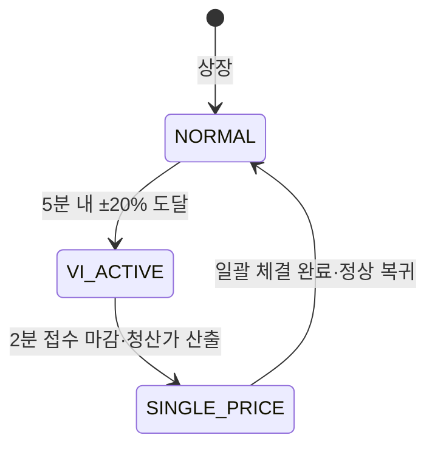

**게임 플레이 세션 상태**

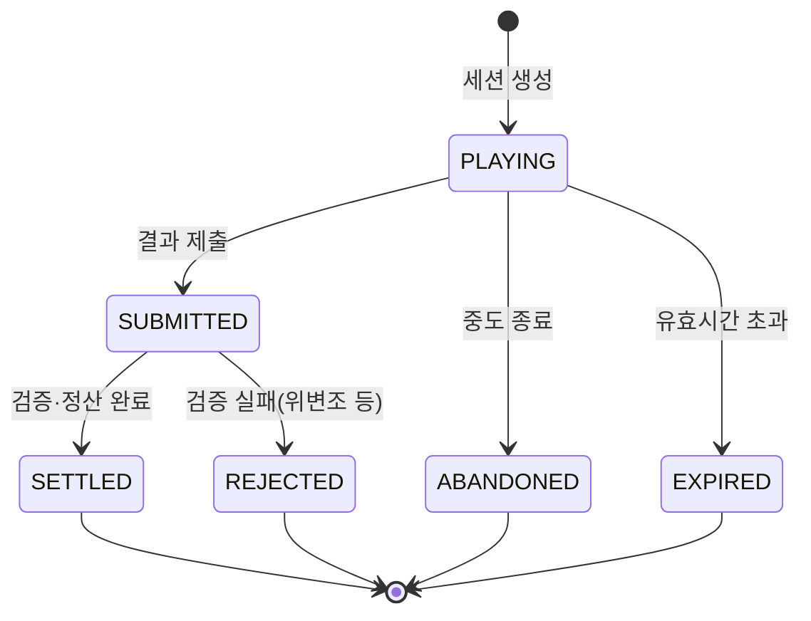

**공매도 포지션 상태**

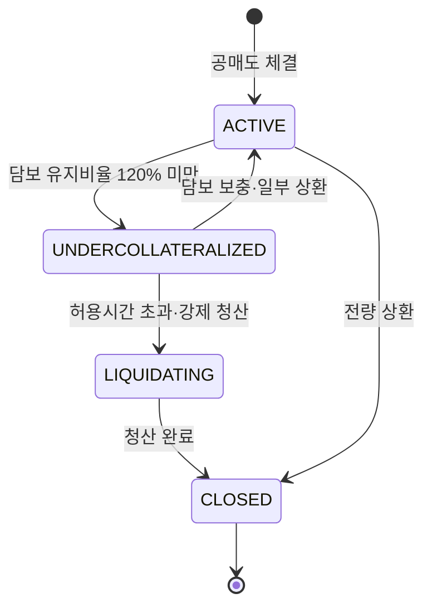

---

## 3. System Architecture
물리적/논리적 컴포넌트의 구성과 데이터 통신 방식을 정의합니다.

### 3.1 아키텍처 개요
3계층 구조(Presentation / Application / Data)를 기반으로, 도메인별로 분리된 서비스 컴포넌트로 구성합니다. 실시간성이 핵심인 거래 도메인은 In-Memory 매칭 엔진 + Redis Pub/Sub로 처리하고, 무결성이 핵심인 정산·원장은 PostgreSQL 트랜잭션으로 보장합니다. AI 게시글 생성은 로컬 추론 환경으로 **격리**되어 장애가 시스템 전체로 전파되지 않습니다.

### 3.2 컴포넌트 구성

| 계층 | 컴포넌트 | 책임 | 기술 |
| :--- | :--- | :--- | :--- |
| Presentation | Web App | 대시보드·거래·커뮤니티·마이페이지 UI | React |
| Presentation | Mobile App | 동일 기능 크로스플랫폼 앱 | Flutter |
| Presentation | Admin Back-office | 운영자 전용 화면 — 신고 콘텐츠 검토(유지/숨김/삭제), 공시 발행, 게임·종목 정책 관리 | React/Vue |
| Application | **API Gateway** | 인증, 라우팅, 요청 검증, Rate Limit | Node.js/Spring |
| Application | Auth Service | 이메일 인증, 회원가입 트랜잭션, 세션/토큰 | — |
| Application | Email Sender | 인증번호 발송 | SMTP |
| Application | Market Data Service | 종합지수·시세 스냅샷·캔들·랭킹 제공(REST + 폴링 폴백) | — |
| Application | **Trading Service** | 주문 검증, 예수금/수량 예약, 주문 기록 | — |
| Application | **Matching Engine** | 종목별 In-Memory 오더북, 가격·시간 우선 연속 경매, VI 단일가 경매, 체결 이벤트 생성 | — |
| Application | LP Provider | 유동성 공급 정책(슬리피지 ≤0.5%) | — |
| Application | Settlement / Ledger Service | 체결 정산(수수료 0.1%), 원장 기록, 중복 처리 방지 | — |
| Application | Community Service | 게시글·공감·댓글·신고·공시 카드 | — |
| Application | **AI 생성 서비스** | 로컬 LLM 게시글 생성·검증, 템플릿 폴백 | Python(FastAPI) |
| Application | 로컬 LLM | Qwen3 1.7B 추론(외부 API 미사용, 재학습 불필요) | Ollama |
| Application | Scheduler | 포아송 기반 AI 발행, 이자·배당, VI/담보 감시, 세션 만료, 입찰 마감, 자산 스냅샷 | — |
| Application | Arcade Service | 게임 세션, 결과 검증, 보상·일일 한도 | — |
| Application | Asset / Portfolio Service | 총평가자산 집계, 보유 종목, 내역 조회, 입찰 예수금 예약 | — |
| Application | Central Bank Module | 기준금리·이자율 정책, 이자·배당 지급, 수수료·낙찰금 소각 | — |
| Application | Notification Service | 알림 대상 선정·저장·전달 | — |
| Application | WebSocket Gateway | Redis Pub/Sub 구독 → 클라이언트 브로드캐스트 | — |
| Data | **PostgreSQL** | ACID 트랜잭션 — 원장(Ledger), 주문·체결, 계좌, 커뮤니티 영구 저장 | — |
| Data | **Redis** | Pub/Sub 이벤트 브로드캐스팅, 오더북/시세 캐싱, 분산 락(중복 실행 방지) | — |
| Data | **Object Storage** | 미디어/에셋 저장 — 오락실 썸네일, 전광판 배너 이미지, 공시 첨부 등 | AWS S3 호환(MinIO 등) |

### 3.3 아키텍처 다이어그램

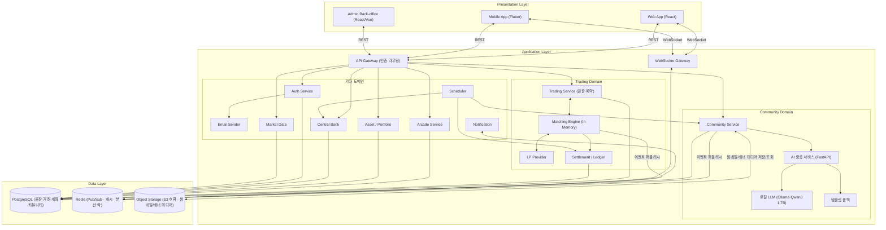

### 3.4 통신 방식

| 구간 | 방식 | 용도 |
| :--- | :--- | :--- |
| 클라이언트 ↔ API Gateway | REST (HTTPS) | 데이터 조회·주문·글 작성·입찰 등 요청/응답 (Idempotency-Key 포함) |
| 클라이언트 ↔ WebSocket Gateway | WebSocket | 실시간 지수·시세·호가·체결·공시·공감·알림 스트리밍 |
| 클라이언트 ↔ Market Data (폴백) | HTTP 폴링(5초) | WS 끊김 시 스냅샷 조회 → 재연결 후 보정 |
| 서비스 ↔ 매칭 엔진 | 내부 큐/직접 호출 | 주문 등록·취소, 종목별 순차 처리 보장 |
| 커뮤니티 ↔ AI 생성 서비스 | 제한시간 있는 내부 HTTP | 게시글 생성 요청(장애 시 템플릿 폴백) |
| 서비스 ↔ Redis | Pub/Sub · 분산 락 | 이벤트 브로드캐스팅, 스케줄러·발행 작업 중복 실행 방지 |
| 서비스 ↔ PostgreSQL | 트랜잭션(ACID) | 주문·체결·정산·원장·계좌·커뮤니티 영구 저장 |
| 서비스 ↔ Object Storage | Presigned URL / SDK | 오락실 썸네일·전광판 배너 이미지 등 미디어 업로드·조회 |

### 3.5 핵심 설계 결정

1. **원자성**: 회원가입+초기지급, 체결 정산+원장, 게임 보상 지급, 입찰 기록+예약은 단일 DB 트랜잭션으로 처리 (불완전 상태 원천 차단).
2. **중복 방지**: 주문·입찰·게임 결과 제출의 Idempotency Key, 체결 ID·세션 ID 기반 이중 정산/이중 지급 차단.
3. **순서 보장**: 종목별 매칭 직렬화로 동일 종목 오더북 변경 충돌 방지, 가격 우선·시간 우선 원칙 보장.
4. **실시간 + 폴백**: WS 스트리밍을 기본으로 하고, 연결 끊김 시 5초 폴링으로 자동 전환 후 재연결 시 스냅샷 보정.
5. **AI 격리**: 로컬 LLM 추론은 비동기·제한시간으로 처리하여 모델 지연/장애가 피드 조회·작성·주문 처리에 영향을 주지 않음. 모델 장애 시 템플릿 폴백으로 피드 지속성 보장.
6. **통화 정책**: 수수료(0.1%)·대차 수수료(일 0.05%)·전광판 낙찰금은 중앙은행 모듈에서 **소각(영구 유출)** 처리 — 인플레이션 제어. 오락실 보상은 일일 한도로 통화 유입 제한.

---

## 4. Sequence Diagrams (시퀀스 다이어그램)
요구사항의 핵심 처리 흐름을 시퀀스 다이어그램으로 정의합니다.

### SD-01: 회원가입 및 초기 자산 지급 (SCR-01)

1. 이용자가 학교 이메일 입력 → `.ac.kr` 검증 → 6자리 인증번호 발급(3분) → 메일 발송.
2. 인증번호 검증(3회 실패 시 5분 잠금) → 프로필 설정 → 최종 검증.
3. 가입 요청 접수 시 **멱등성 키(Idempotency-Key) 검증 + Redis 분산 락(Lock)** 으로 다중 클릭·중복 요청을 차단 (기존 처리 존재 시 저장된 결과 반환).
4. 단일 트랜잭션으로 계정·지갑·예금계좌 생성 + 1,000,000P 지급(1회) + Ledger 기록 → 락 해제·멱등성 결과 캐시.
5. 세션 발급 후 완료 모달 데이터(금리·지수·브리핑) 반환.

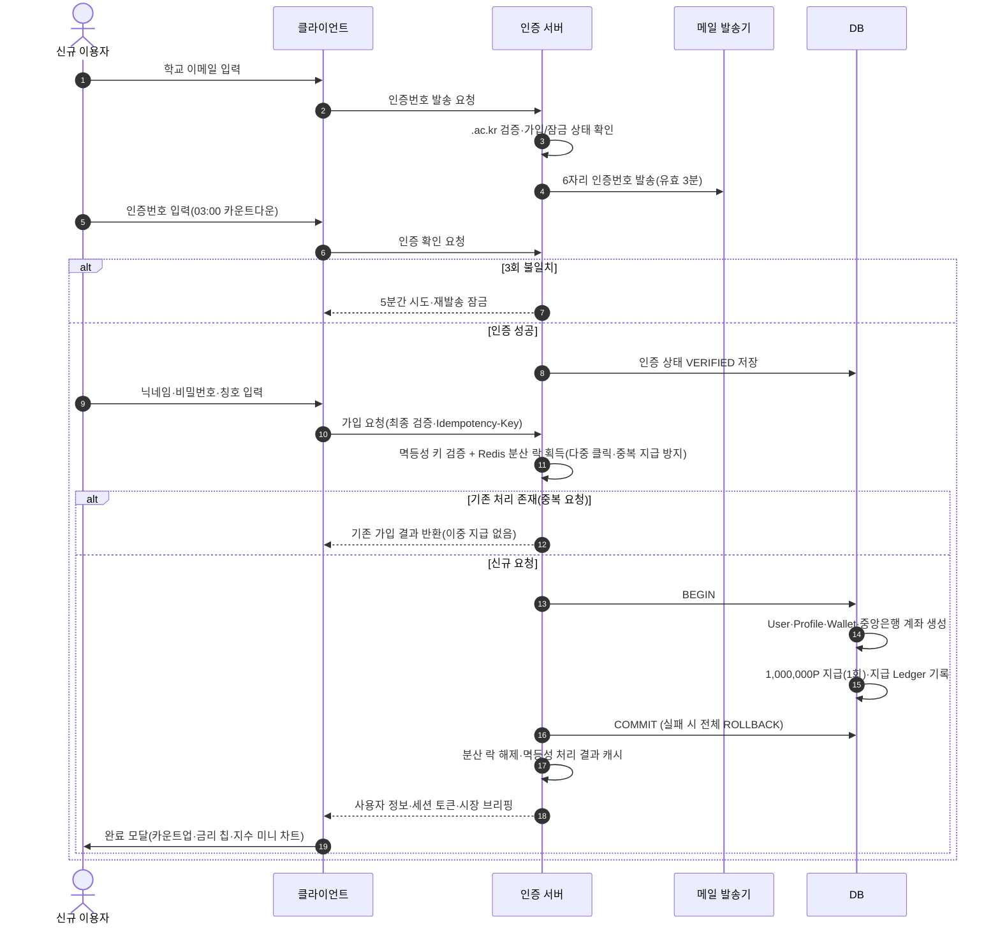

### SD-02: 실시간 시세 구독 및 폴링 폴백 (SCR-02)

1. 대시보드 진입 → REST로 초기 스냅샷(지수·랭킹·공시·정책) 조회.
2. WS 구독 후 이벤트 수신 → 버전 비교하여 최신만 반영.
3. 연결 끊김 시 5초 폴링 전환 → 재연결 성공 시 전체 스냅샷 보정 후 폴링 중단.

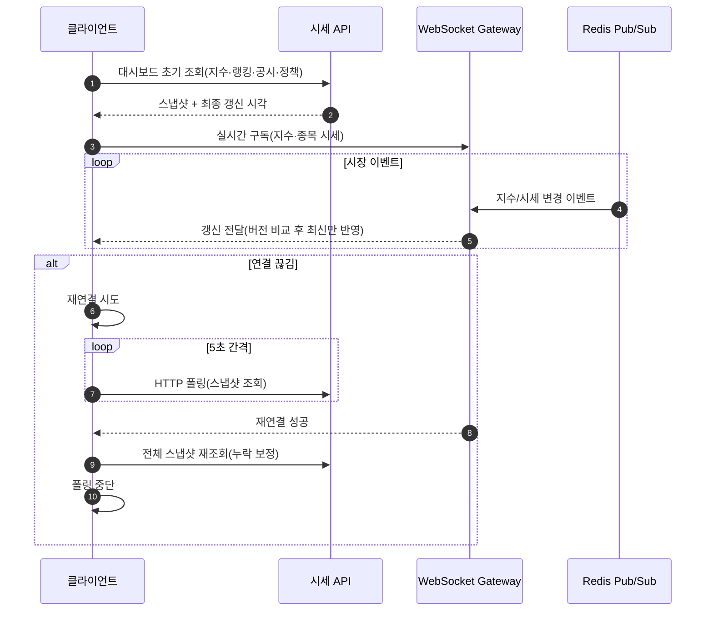

### SD-03: 주문 접수 → 연속 경매 매칭 → 정산 → 브로드캐스트 (SCR-03)

1. 클라이언트가 주문(Idempotency-Key 포함) 전송 → 서버가 권한·종목 상태·예수금/잔량 검증.
2. 통과 시 예수금/수량 예약 후 주문 기록(NEW) → 매칭 큐 등록.
3. 매칭 엔진이 가격·시간 우선 탐색 → (필요 시) LP 유동성 검증(슬리피지 ≤0.5%) 후 체결.
4. 정산 트랜잭션(수수료 0.1%·잔고 반영·Ledger) — 원자성 보장.
5. 잔량 처리(지정가: 오더북 등록 / 시장가: 취소) → 주문 상태 확정.
6. WS로 호가·체결·잔고 이벤트 브로드캐스팅 → 클라이언트 UI 갱신.

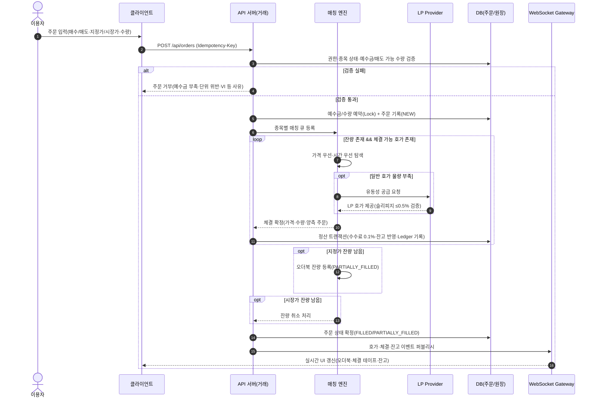

### SD-04: 미체결 주문 취소 (SCR-03)

1. 이용자가 미체결 주문 취소 요청 → 서버가 취소 가능 잔량 확인.
2. 잔량 존재 시 오더북 제거 → 상태 `CANCELED` → 예약 예수금/수량 해제.
3. 취소와 체결 동시 발생 시 서버 확정 순서 따름. 거래일 종료 시 잔여 지정가 자동 취소.

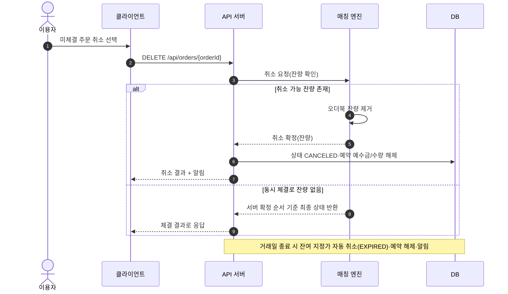

### SD-05: VI 발동 및 단일가 매매 (SCR-03 §11)

1. 매칭 엔진이 최근 5분 변동률 감시 → ±20% 도달 시 상태 `VI_ACTIVE` 전환·연속 경매 중단.
2. 2분간 단일가 주문 접수(클라이언트는 VI 오버레이·누적 그래프 전환).
3. 마감 후 청산가격(Clearing Price) 산출 → 일괄 체결 → 정산·원장 → 정상 복귀.

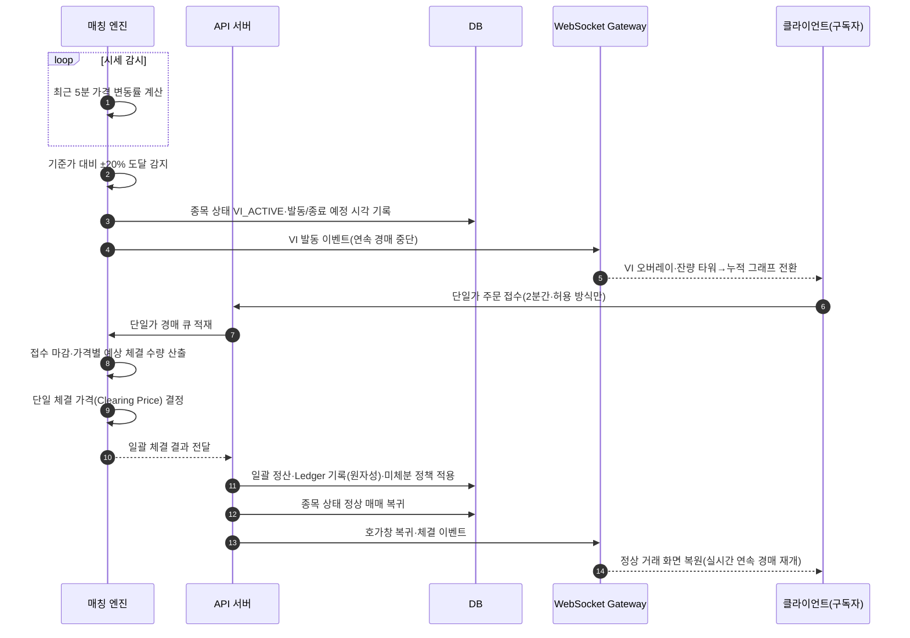

### SD-06: 공매도 대차·상환·강제 청산 (SCR-03 §12, SCR-06 §9~10)

1. 공매도 주문 → 대차 가능 수량·담보(120%) 검증 → 대차 처리·담보 예약 → 일반 매도 매칭.
2. 체결 시 ShortPosition 생성·대차료(일 0.05%) 기록.
3. 주기적 담보 감시 → 120% 미만 시 경고 → 해소 실패 시 강제 청산 주문(부분 체결·LP 백스톱 허용).
4. 상환 요청 → 매수/보유 주식으로 상환 확정 → 담보 해제·Ledger 기록.

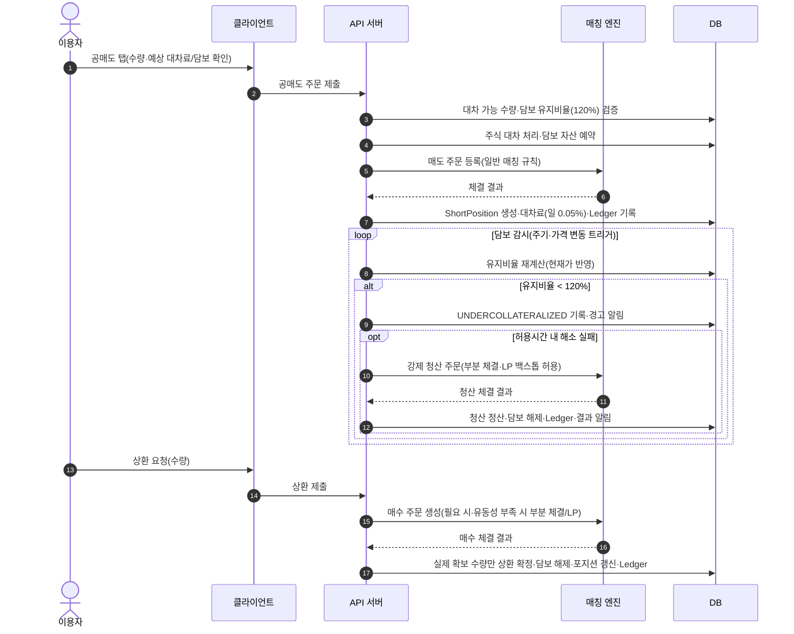

### SD-07: 게시글 작성·포지션 인증·피드 반영 (SCR-04 §1~5)

1. 태그+본문(≤500자) 등록 → 권한·길이·금칙어 검증.
2. 태그와 실제 포지션 대조 → 일치 시 인증 뱃지 부착(불일치·조회 실패 시 뱃지 없이 등록 허용).
3. 저장 → WS 새 글 이벤트 → `새 글` 하이라이트·우선 노출.

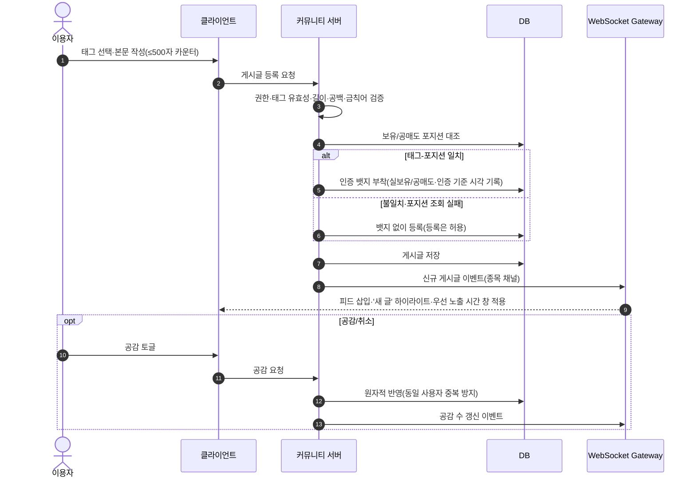

### SD-08: AI 참여자 정기 게시글 발행 — 로컬 LLM + 템플릿 폴백 (SCR-04 §6~8, §13)

1. 스케줄러가 포아송 간격으로 발행 작업 트리거(중복 실행 방지 락).
2. AI 상태·포지션·손익 조회 → 상황 코드 결정(HOLD_PROFIT 등).
3. 로컬 LLM(Ollama·Qwen3 1.7B)에 제한시간 내 생성 요청 — 개인정보·인증 정보 미전달.
4. 타임아웃/OOM 시 템플릿 폴백 → 검증(500자·금칙어·보유 모순·중복도) 통과 시 발행.
5. 생성 방식·모델 버전·운영 지표 기록. AI 글은 일반 글과 동일 UI로 표시.

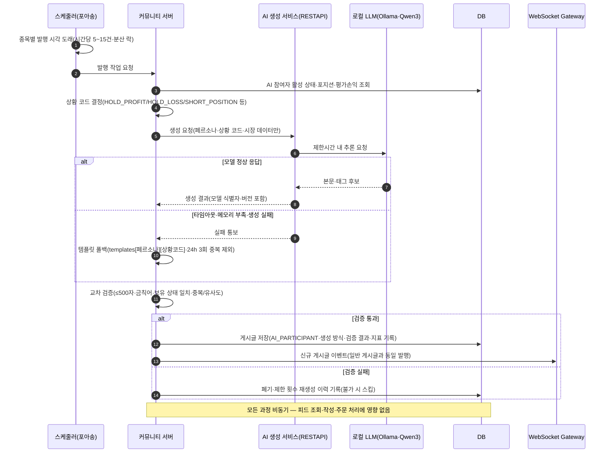

### SD-09: 사용자 게시글 AI 지연 반응 (SCR-04 §9)

1. 유저 글 저장 후 반응 작업을 백그라운드 큐에 등록.
2. 종목명·별칭 사전으로 종목 추출 → 보유 AI 0~3명 선정.
3. 각 AI마다 30초~10분 지연 후 재확인 → 공감/댓글 생성·검증 → 저장 → WS 갱신.

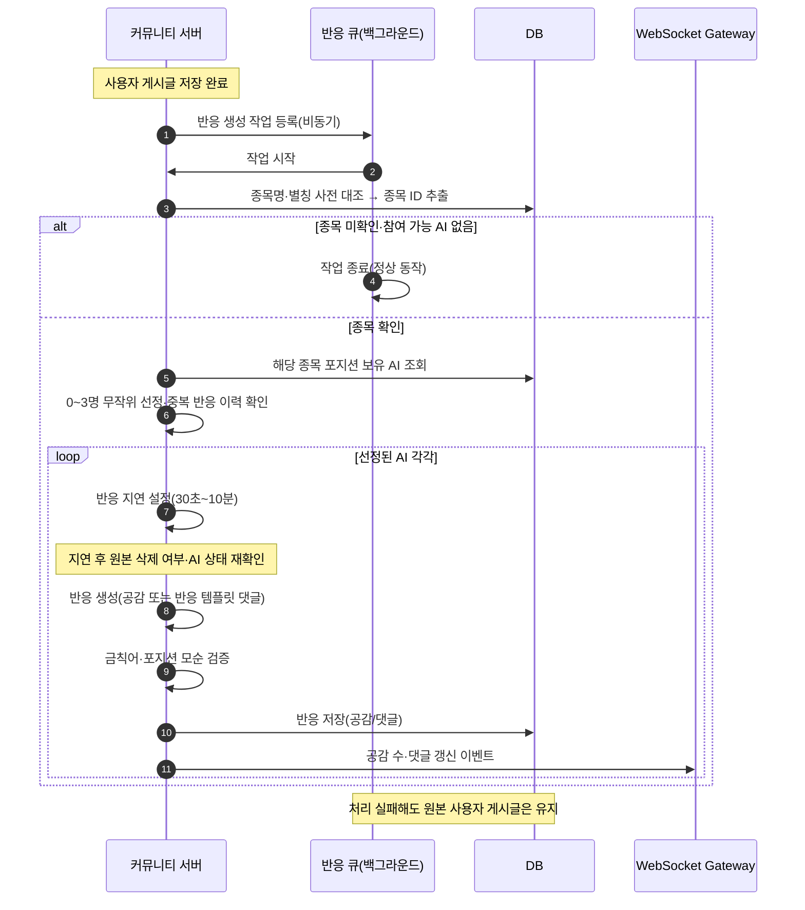

### SD-10: 공시 발행 및 알림 (SCR-04 §10~11)

1. 발행 주체가 공시 등록 → 권한·필수 항목 검증 → 저장·영향 태그 결정.
2. 대상 종목 연결 → 종목 채널 공시 카드 이벤트.
3. 알림 대상 선정(관심 등록, 가입 이후 이벤트만) → 저장 → WS 전달 → 미확인 수 갱신.

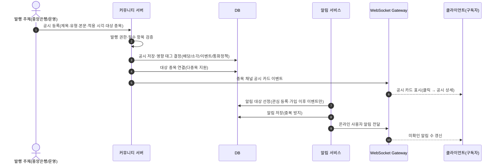

### SD-11: 오락실 플레이·결과 검증·보상 지급 (SCR-05)

1. 게임 세션 생성 → 플레이 → 결과 제출(세션 ID).
2. 서버 검증 모듈이 점수 재산출(클라이언트 점수 불신) → 위변조 시 거부.
3. 보상 계산 → 일일 한도 검증(동시성 제어) → 지급 트랜잭션(입금+누적+Ledger+세션 SETTLED, 원자성).
4. 동일 세션 재제출 시 기존 정산 결과 반환(1회 지급 보장).

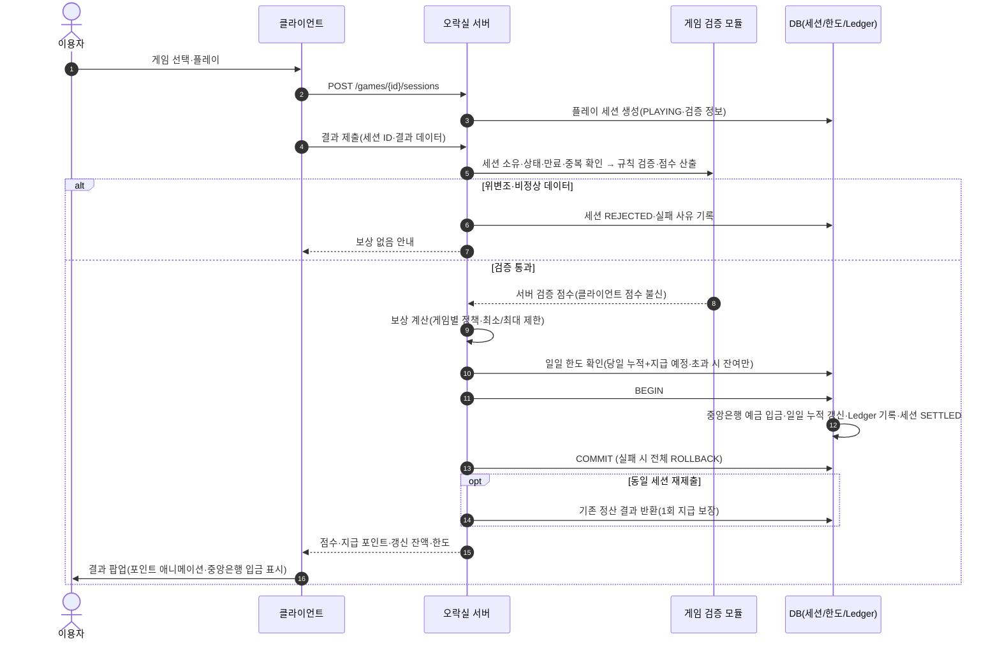

### SD-12: 전광판 입찰·낙찰 정산 (SCR-06 §13~15)

1. 입찰 제출(Idempotency) → 슬롯·금액·콘텐츠·예수금 검증 → 기록+예약(원자성) → 최고가 갱신 WS.
2. AI 참여자 입찰로 최고가 계속 갱신.
3. 마감 → 최고가·선접수 우선 낙찰 선정 → 낙찰금 정산·소각, 비낙찰 예약 해제 → 광고 노출 연결 → 결과 알림.

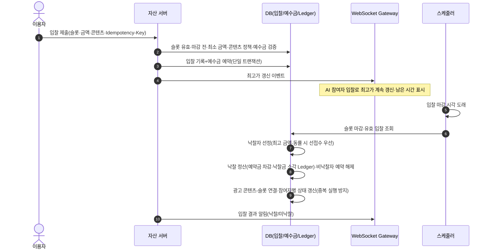

### SD-13: 관리자 백오피스 — 신고 콘텐츠 검토·처리 및 공시 발행 (SCR-04 §12, §10~11)

1. 관리자가 백오피스(Admin Back-office)에서 신고 목록 조회(대상·사유·신고 수) → 대상 콘텐츠 확인.
2. 검토 후 유지/숨김/삭제 결정 → 콘텐츠 상태 변경·처리 이력 기록 → 종목 채널에 변경 이벤트 전달(피드에서 제외 반영). AI 참여자 게시글에도 동일 기준 적용.
3. 공시 발행: 제목·유형·본문·적용 시각·대상 종목 등록 → 발행 권한·필수 항목 검증 → 저장·영향 태그 결정 → 종목 연결 → 공시 카드 이벤트 + 알림 전달.

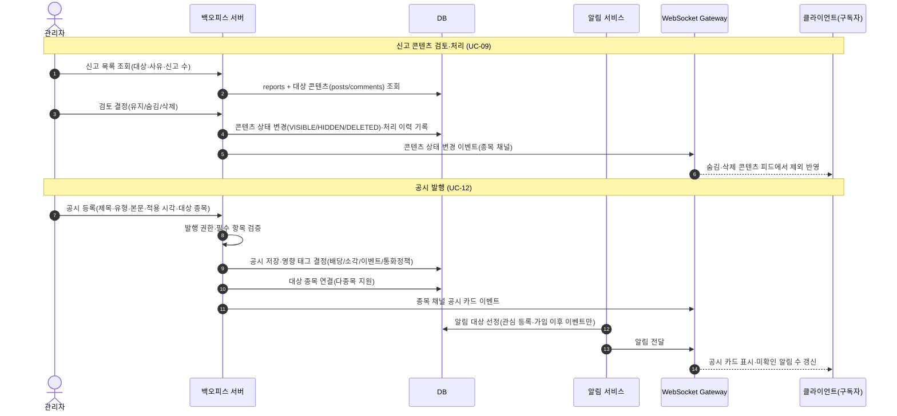

### SD-14: 실시간 포트폴리오 및 총평가 자산 집계 (SCR-06 §1~6)

1. 마이페이지 진입 → 자산 서버가 지갑 잔액(사용 가능/예약 구분)·중앙은행 예금·보유 종목(수량·평균 매입가)·미체결 주문 조회.
2. 최신 시세 스냅샷 기준 종목별 평가금액·평가손익·수익률 계산 + 공매도 부채 평가 반영 → **총평가 자산 산출** (예약·담보·이체 금액 중복 합산 방지, 평가 기준 시각 포함).
3. WS 시세 이벤트로 실시간 재평가(시세만으로 확정 잔고 임의 변경 없음), 체결·정산 발생 시 서버 확정 스냅샷 재조회로 동기화.

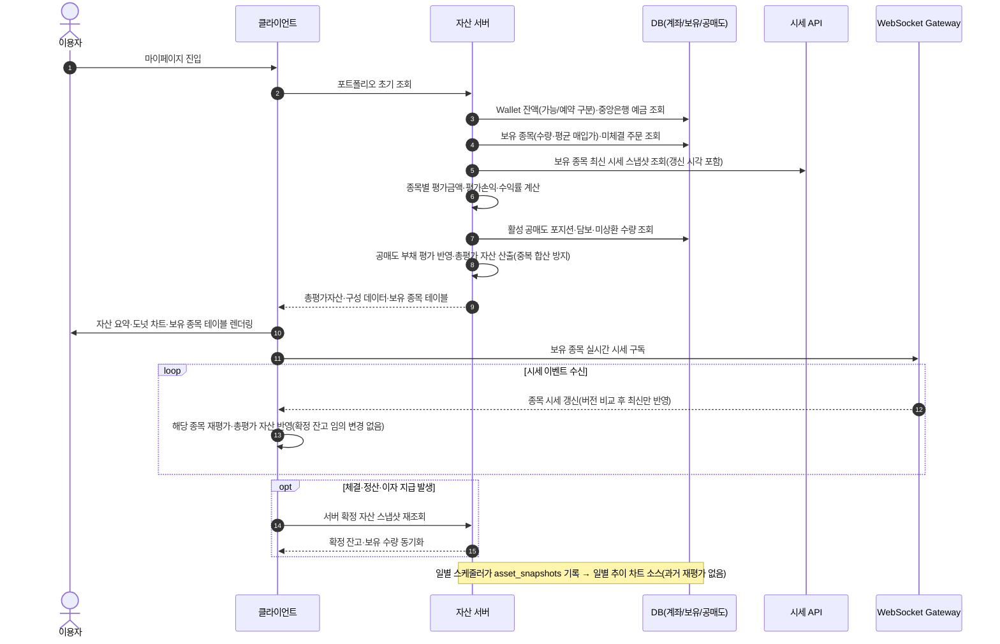

### SD-15: 중앙은행 이자·배당 일괄 지급 Batch (SCR-06 §11~12)

1. 중앙은행 스케줄러가 Redis 분산 락으로 중복 실행 방지 후 이자 지급 Batch 시작.
2. 현재 정책(예수금 이자율)·활성 예금 계좌 명부 조회 → 계좌별 이자 계산(기준 잔액 × 금리) → 예금 입금 + interest_grants/Ledger(INTEREST) 기록 (청크 단위 트랜잭션, 원자성).
3. 배당 기준일 도래 → 배당 공시(주당 금액)·기준일 보유 명부 조회 → 보유자별 배당 계산(기준 수량 × 주당 금액) → 입금 + dividend_grants/Ledger(DIVIDEND) 기록.
4. 지급 완료 이벤트·알림 전달(자산 위젯·내역 탭 갱신, 배당은 공시 상세 연결).

```mermaid
sequenceDiagram
    autonumber
    participant SC as 중앙은행 스케줄러
    participant CB as 중앙은행 모듈
    participant D as DB
    participant W as WebSocket Gateway
    participant C as 클라이언트(수신자)

    SC->>SC: 이자 지급 주기 도래(분산 락으로 중복 실행 방지)
    SC->>CB: 이자 지급 Batch 시작
    CB->>D: 현재 정책(예수금 이자율)·활성 예금 계좌 명부 조회
    loop 계좌별 처리(청크 단위)
        CB->>D: BEGIN
        D->>D: 이자 계산(기준 잔액×이자율)·예금 입금
        D->>D: interest_grants 기록·Ledger(INTEREST) 저장(중복 방지)
        CB->>D: COMMIT (실패 시 ROLLBACK·재처리 대상 보존)
    end
    CB->>W: 이자 지급 완료 이벤트(자산 위젯 갱신)
    SC->>SC: 배당 기준일 도래
    SC->>CB: 배당 지급 Batch 시작
    CB->>D: 배당 공시(주당 금액)·기준일 보유 명부 조회
    loop 보유자별 처리(청크 단위)
        CB->>D: BEGIN
        D->>D: 배당 계산(기준 수량×주당 금액)·예금 입금
        D->>D: dividend_grants 기록·Ledger(DIVIDEND) 저장
        CB->>D: COMMIT
    end
    CB->>W: 배당 지급 완료 이벤트
    W-->>C: 입금 알림·자산 갱신(배당 내역 → 공시 상세 연동)
```

---

## 5. Class Diagram (Domain Models)
시스템을 구성하는 주요 도메인 객체의 속성과 역할을 정의합니다.

### 5.1 도메인 클래스 다이어그램

```mermaid
classDiagram
    class Participant {
        <<abstract>>
        +UUID id
        +String nickname
        +ParticipantType type
        +DateTime joinedAt
    }
    class User {
        +String email
        +String passwordHash
        +String schoolDomain
        +verifyEmailCode()
        +changeNickname()
    }
    class AIParticipant {
        +String personaCode
        +boolean active
        +DateTime lastPostedAt
        +decideSituationCode(holding)
    }
    class Admin {
        +String email
        +reviewReport(report)
        +publishDisclosure(disclosure)
        +manageContentPolicy()
    }
    class AdContent {
        +String mediaUrl
        +ContentStatus status
        +validateExposurePolicy()
    }
    class Title {
        +String name
    }
    class Wallet {
        +Decimal available
        +Decimal reserved
        +lockFunds(amount)
        +unlockFunds(amount)
        +settleBuy(amount, fee)
        +credit(amount)
    }
    class BankAccount {
        +Decimal balance
        +applyInterest(policy)
    }
    class CentralBankPolicy {
        +Decimal baseRate
        +Decimal depositRate
        +boolean lpEnabled
        +burn(feeAmount)
    }
    class Stock {
        +String code
        +String name
        +StockCategory category
        +TradingState state
        +long listedShares
        +updateTradingState(state)
    }
    class Candle {
        +CandleInterval interval
        +Decimal open
        +Decimal high
        +Decimal low
        +Decimal close
        +long volume
    }
    class Orderbook {
        +enqueue(order)
        +match(order)
        +cancel(orderId)
        +snapshot(depth)
        +calcClearingPrice()
    }
    class Order {
        +OrderSide side
        +OrderKind kind
        +Decimal price
        +int quantity
        +int filledQuantity
        +OrderStatus status
        +String idempotencyKey
        +applyFill(price, qty)
        +cancelRemainder()
    }
    class Trade {
        +Decimal price
        +int quantity
        +Decimal buyerFee
        +Decimal sellerFee
    }
    class Holding {
        +int quantity
        +Decimal avgPrice
        +applyFill(side, price, qty)
    }
    class ShortPosition {
        +int openQuantity
        +Decimal avgEntryPrice
        +Decimal borrowFeeRate
        +Decimal collateral
        +marginRatio(currentPrice)
        +repay(qty)
        +forceLiquidate()
    }
    class LedgerEntry {
        +LedgerTxType txType
        +Decimal amount
        +Decimal balanceAfter
        +String refType
        +UUID refId
    }
    class Post {
        +PostTag tag
        +String content
        +VerificationType verification
        +GenerationMethod genMethod
        +String modelId
        +verifyPosition(holding, short)
        +softDelete()
    }
    class Comment {
        +String content
        +GenerationMethod genMethod
    }
    class Reaction {
        +toggle()
    }
    class Report {
        +ReportReason reason
        +ReportStatus status
        +resolve(action)
    }
    class Disclosure {
        +DisclosureType type
        +String title
        +String body
        +DateTime effectiveAt
        +resolveImpactTags()
    }
    class Notification {
        +NotificationType type
        +UUID refId
        +DateTime readAt
        +markRead()
    }
    class Game {
        +GameCode code
        +RewardPolicy rewardPolicy
        +validateOutcome(session)
    }
    class GameSession {
        +GameSessionState state
        +int serverScore
        +int grantedPoints
        +settle(points)
    }
    class BannerSlot {
        +DateTime startsAt
        +DateTime endsAt
        +DateTime bidCloseAt
        +Decimal minBid
        +closeBidding()
    }
    class Bid {
        +Decimal amount
        +BidStatus status
        +String idempotencyKey
        +markWon()
        +markLost()
    }

    Participant <|-- User
    Participant <|-- AIParticipant
    Participant <|-- Admin
    User "1" --> "0..*" Title : 보유 칭호
    Participant "1" *-- "1" Wallet : 지갑
    Participant "1" *-- "1" BankAccount : 중앙은행 예금 계좌
    Stock "1" *-- "0..*" Candle : 시세
    Stock "1" --> "1" Orderbook : 종목별 오더북
    Participant "1" o-- "0..*" Order : 주문
    Order "0..*" --> "1" Stock : 대상 종목
    Orderbook "1" o-- "0..*" Order : 호가 등록
    Trade "*" --> "2" Order : 매수·매도 주문
    Participant "1" o-- "0..*" Holding : 보유 종목
    Holding "0..*" --> "1" Stock
    Participant "1" o-- "0..*" ShortPosition : 공매도 포지션
    ShortPosition "0..*" --> "1" Stock
    LedgerEntry "0..*" --> "1" Participant : 소유
    LedgerEntry "0..*" --> "0..1" Order : 연관 주문
    Stock "1" *-- "0..*" Post : 종목 피드
    Participant "1" o-- "0..*" Post : 작성
    Post "1" o-- "0..*" Reaction : 공감
    Post "1" o-- "0..*" Comment : 댓글
    Reaction "0..*" --> "1" Participant : 공감자
    Comment "0..*" --> "1" Participant : 작성자(AI 반응 포함)
    Post "0..*" o-- "0..*" Report : 신고
    Disclosure "0..*" --> "0..*" Stock : 대상 종목(다대다)
    Participant "1" o-- "0..*" Notification : 수신
    Game "1" o-- "0..*" GameSession : 세션
    Participant "1" o-- "0..*" GameSession : 플레이
    BannerSlot "1" o-- "0..*" Bid : 입찰
    Participant "1" o-- "0..*" Bid : 입찰 참여
    Bid "0..*" --> "1" AdContent : 광고 콘텐츠
    Participant "1" o-- "0..*" AdContent : 등록
    Admin "1" --> "0..*" Report : 신고 검토(유지/숨김/삭제)
    Admin "1" --> "0..*" Disclosure : 공시 발행
    CentralBankPolicy "1" ..> "0..*" BankAccount : 이자 적용
```

### 5.2 클래스 책임 요약

| 클래스 | 책임 | 관련 UC | 매핑 테이블 |
| :--- | :--- | :--- | :--- |
| Participant/User/AIParticipant | 참여자 추상화 — 실유저와 AI 참여자에 **동일 규칙** 적용 | 전체 | users |
| Wallet | 사용 가능/예약 예수금 관리, 주문 예약·정산 | UC-01, 03, 16 | wallets |
| BankAccount | 중앙은행 예금 잔액, 이자·게임 보상·배당 입금 | UC-01, 13, 15 | bank_accounts |
| CentralBankPolicy | 기준금리·이자율·LP 가동 상태, 수수료·낙찰금 소각 | UC-02, 12, 15, 16 | central_bank_policies |
| Stock/Candle | 종목 정보·거래 상태(VI), 시세 캔들 | UC-02, 03, 05 | stocks, candles |
| Orderbook | 종목별 호가 관리, 연속 경매 매칭, 단일가 청산가 산출 | UC-03~05 | (In-Memory + Redis) |
| Order | 주문 수명주기(접수→체결→취소/만료), Idempotency | UC-03, 04 | orders |
| Trade | 체결 결과(가격·수량·양측 수수료) | UC-03, 05 | trades |
| Holding/ShortPosition | 보유 수량·평균 단가 / 대차·담보·유지비율·상환·청산 | UC-03, 06, 07 | holdings, short_positions |
| LedgerEntry | 모든 자산 변동의 불변 원장 (TRADE/FEE/BURN/INTEREST/DIVIDEND/REWARD/BID) | 전체 | ledger |
| Post/Comment/Reaction/Report | 커뮤니티 콘텐츠 — 생성 방식(USER/LOCAL_MODEL/TEMPLATE)과 검증 상태 기록, AI 글도 동일 기준 관리 | UC-08~11 | posts, comments, reactions, reports |
| Disclosure | 공시(배당/소각/이벤트/통화정책) 발행·영향 태그·종목 연결 | UC-12 | disclosures |
| Notification | 알림 저장·읽음 처리, 가입 이전 이벤트 제외 | UC-12 | notifications |
| Game/GameSession | 게임 정책·결과 검증, 세션 상태·서버 산출 점수·지급 포인트 | UC-13 | games, game_sessions |
| BannerSlot/Bid | 전광판 슬롯·입찰·낙찰 상태 | UC-16 | banner_slots, bids |
| AdContent | 전광판 광고 콘텐츠(미디어 URL·노출 정책 검증) — Object Storage 연동 | UC-16 | ad_contents |
| Admin | 백오피스 운영자 — 신고 콘텐츠 검토(유지/숨김/삭제), 공시 발행, 콘텐츠 정책 관리 | UC-09, UC-12 | users(user_type=ADMIN), reports, disclosures |

### 5.3 서비스 계층 주요 클래스

| 서비스 클래스 | 핵심 협력 | 책임 |
| :--- | :--- | :--- |
| MatchingEngine | Orderbook, LP Provider, ViMonitor | 종목별 직렬화 처리, 가격·시간 우선 매칭, VI 감시·단일가 전환 |
| SettlementService | Wallet, Holding, LedgerEntry | 체결 정산(수수료 0.1%), 원장 기록, 체결 ID 중복 방지 |
| AiPostGenerator | LocalLlmClient(Ollama), TemplateGenerator, PostValidator | 상황 코드 기반 생성, 제한시간 추론, 교차 검증, 폴백 전환, 운영 지표 수집 |
| ReactionWorker | 종목명 사전, AIParticipant | 지연 반응 스케줄링(30초~10분), 0~3명 선정, 중복 방지 |
| ArcadeService | GameSession, RewardPolicy, DailyLimitService | 결과 검증·점수 산출, 일일 한도 동시성 제어, 지급 트랜잭션 |
| CentralBankService | CentralBankPolicy, BankAccount, LedgerEntry | 이자·배당 지급, 소각, 통화정책 조회 |
| NotificationService | Notification, WebSocket Gateway | 대상 선정(가입 이후 이벤트), 저장·전달·중복 방지 |

---

## 6. Database Schemas
시스템의 결제 무결성을 유지하기 위한 RDBMS(PostgreSQL) 핵심 테이블 구조입니다.

### 6.1 Entity Relationship Diagram (ERD)

```mermaid
erDiagram
    USERS ||--o| WALLETS : "1인 1지갑"
    USERS ||--o| BANK_ACCOUNTS : "예금계좌"
    USERS ||--o{ EMAIL_VERIFICATIONS : "인증요청"
    USERS ||--o{ USER_TITLES : "칭호보유"
    TITLES ||--o{ USER_TITLES : "칭호"
    USERS ||--o{ ORDERS : "주문"
    USERS ||--o{ HOLDINGS : "보유"
    USERS ||--o{ SHORT_POSITIONS : "공매도"
    USERS ||--o{ LEDGER : "원장"
    USERS ||--o{ POSTS : "작성"
    USERS ||--o{ COMMENTS : "댓글"
    USERS ||--o{ REACTIONS : "공감"
    USERS ||--o{ NOTIFICATIONS : "수신"
    USERS ||--o{ GAME_SESSIONS : "플레이"
    USERS ||--o{ BIDS : "입찰"
    USERS ||--o{ ASSET_SNAPSHOTS : "자산스냅샷"
    STOCKS ||--o{ ORDERS : "대상"
    STOCKS ||--o{ TRADES : "체결"
    STOCKS ||--o{ CANDLES : "시세"
    STOCKS ||--o{ STOCK_QUOTES : "스냅샷"
    STOCKS ||--o{ POSTS : "피드"
    STOCKS ||--o{ HOLDINGS : "종목"
    STOCKS ||--o{ SHORT_POSITIONS : "종목"
    ORDERS ||--o{ TRADES : "체결내역"
    DISCLOSURES ||--o{ DISCLOSURE_STOCKS : "연결"
    STOCKS ||--o{ DISCLOSURE_STOCKS : "연결"
    POSTS ||--o{ REACTIONS : "공감"
    POSTS ||--o{ COMMENTS : "댓글"
    POSTS ||--o{ REPORTS : "신고"
    GAMES ||--o{ GAME_SESSIONS : "세션"
    BANNER_SLOTS ||--o{ BIDS : "입찰"
    AD_CONTENTS ||--o{ BIDS : "광고컨텐츠"

    USERS {
        uuid id PK
        varchar email UK
        varchar nickname UK
        varchar password_hash
        varchar user_type
        varchar school_domain
        timestamp joined_at
    }
    WALLETS {
        uuid id PK
        uuid user_id FK
        decimal available
        decimal reserved
    }
    BANK_ACCOUNTS {
        uuid id PK
        uuid user_id FK
        decimal balance
    }
    STOCKS {
        uuid id PK
        varchar code UK
        varchar name
        varchar category
        varchar trading_state
        bigint listed_shares
    }
    ORDERS {
        uuid id PK
        uuid user_id FK
        uuid stock_id FK
        varchar side
        varchar kind
        decimal price
        int quantity
        int filled_quantity
        varchar status
        varchar idempotency_key
    }
    TRADES {
        uuid id PK
        uuid stock_id FK
        uuid buy_order_id FK
        uuid sell_order_id FK
        decimal price
        int quantity
        decimal buyer_fee
        decimal seller_fee
    }
    HOLDINGS {
        uuid user_id FK
        uuid stock_id FK
        int quantity
        decimal avg_price
    }
    SHORT_POSITIONS {
        uuid id PK
        uuid user_id FK
        uuid stock_id FK
        int open_quantity
        decimal collateral
        varchar status
    }
    LEDGER {
        uuid id PK
        uuid user_id FK
        uuid order_id FK
        varchar account_type
        varchar tx_type
        decimal amount
        varchar ref_type
        uuid ref_id
    }
    POSTS {
        uuid id PK
        uuid author_id FK
        uuid stock_id FK
        varchar tag
        text content
        varchar verification_type
        varchar generation_method
        varchar status
    }
    DISCLOSURES {
        uuid id PK
        varchar title
        varchar type
        text body
        uuid published_by FK
        timestamp effective_at
    }
    GAME_SESSIONS {
        uuid id PK
        uuid user_id FK
        uuid game_id FK
        varchar state
        int server_score
        int granted_points
    }
    BIDS {
        uuid id PK
        uuid slot_id FK
        uuid bidder_id FK
        decimal amount
        varchar status
        varchar idempotency_key
    }
```

### 6.2 상세 테이블 정의 (핵심 16개)

**1. users 테이블** — 실유저·AI 참여자·관리자 공통
| Column Name | Data Type | Constraints | Description |
| :--- | :--- | :--- | :--- |
| `id` | UUID | PK | 사용자 식별자 |
| `email` | VARCHAR(255) | UNIQUE, NULL 허용(AI는 이메일 없음) | 학교 이메일 주소 (.ac.kr) |
| `nickname` | VARCHAR(12) | UNIQUE, NOT NULL | 사용자 닉네임 (2~12자) |
| `password_hash` | VARCHAR(255) | NOT NULL | 단방향 암호화된 비밀번호 |
| `user_type` | VARCHAR(20) | NOT NULL | USER / AI_PARTICIPANT / ADMIN |
| `school_domain` | VARCHAR(100) | | 학교 도메인 (email에서 추출) |
| `status` | VARCHAR(20) | NOT NULL | ACTIVE / WITHDRAWN |
| `joined_at` | TIMESTAMP | NOT NULL | 가입 일시 (알림 수신 기준점) |

**2. email_verifications 테이블** — 인증번호 발급/검증 이력
| Column Name | Data Type | Constraints | Description |
| :--- | :--- | :--- | :--- |
| `id` | UUID | PK | 인증 요청 식별자 |
| `email` | VARCHAR(255) | NOT NULL, INDEX | 대상 이메일 |
| `code_hash` | VARCHAR(255) | NOT NULL | 6자리 인증번호 해시 |
| `expires_at` | TIMESTAMP | NOT NULL | 만료 시각 (발급 후 3분) |
| `attempt_count` | INT | NOT NULL DEFAULT 0 | 불일치 횟수 |
| `locked_until` | TIMESTAMP | | 3회 실패 시 5분 잠금 |
| `status` | VARCHAR(20) | NOT NULL | PENDING / VERIFIED / EXPIRED |
| `created_at` | TIMESTAMP | NOT NULL | 발급 시각 |

**3. titles / user_titles 테이블** — DB 관리 칭호
| Column Name | Data Type | Constraints | Description |
| :--- | :--- | :--- | :--- |
| `titles.id` | UUID | PK | 칭호 식별자 |
| `titles.name` | VARCHAR(50) | UNIQUE, NOT NULL | 칭호명 |
| `user_titles.user_id` | UUID | FK(users.id), 복합 PK | 사용자 |
| `user_titles.title_id` | UUID | FK(titles.id), 복합 PK | 칭호 |
| `user_titles.equipped` | BOOLEAN | NOT NULL | 현재 장착 칭호 |

**4. wallets 테이블** — 거래 소결제 지갑
| Column Name | Data Type | Constraints | Description |
| :--- | :--- | :--- | :--- |
| `id` | UUID | PK | 지갑 고유 식별자 |
| `user_id` | UUID | FK, UNIQUE (1인 1지갑) | 소유 사용자 ID |
| `available` | DECIMAL(18,2) | NOT NULL DEFAULT 0, CHECK ≥ 0 | 사용 가능 예수금 |
| `reserved` | DECIMAL(18,2) | NOT NULL DEFAULT 0 | 주문/입찰로 예약된 금액 (Lock) |
| `updated_at` | TIMESTAMP | NOT NULL | 최종 갱신 시각 |

**5. bank_accounts 테이블** — 중앙은행 예금 계좌 (이자·게임 보상·배당 수령)
| Column Name | Data Type | Constraints | Description |
| :--- | :--- | :--- | :--- |
| `id` | UUID | PK | 계좌 식별자 |
| `user_id` | UUID | FK, UNIQUE | 소유 사용자 ID |
| `balance` | DECIMAL(18,2) | NOT NULL DEFAULT 0 | 예금 잔액 (이자 계산 대상) |
| `last_interest_at` | TIMESTAMP | | 마지막 이자 지급 시각 |

**6. central_bank_policies 테이블** — 통화정책 이력 (하드코딩 금지)
| Column Name | Data Type | Constraints | Description |
| :--- | :--- | :--- | :--- |
| `id` | UUID | PK | 정책 식별자 |
| `base_rate` | DECIMAL(6,4) | NOT NULL | 기준금리 |
| `deposit_rate` | DECIMAL(6,4) | NOT NULL | 예수금 이자율 |
| `lp_enabled` | BOOLEAN | NOT NULL | LP 가동 상태 |
| `effective_from` | TIMESTAMP | NOT NULL | 적용 시작 |
| `valid_to` | TIMESTAMP | | 적용 종료 (NULL = 현재 정책) |

**7. stocks 테이블** — 종목 마스터
| Column Name | Data Type | Constraints | Description |
| :--- | :--- | :--- | :--- |
| `id` | UUID | PK | 종목 식별자 |
| `code` | VARCHAR(20) | UNIQUE, NOT NULL | 종목 코드 |
| `name` | VARCHAR(100) | NOT NULL | 종목명 |
| `category` | VARCHAR(20) | NOT NULL | DEPT(학과주) / SCHEDULE(학사일정) / MEME(밈코인) |
| `listed_shares` | BIGINT | NOT NULL | 발행 주식 수 (소각 시 감소) |
| `trading_state` | VARCHAR(20) | NOT NULL | NORMAL / VI_ACTIVE / SINGLE_PRICE |
| `borrowable_qty` | INT | NOT NULL DEFAULT 0 | 공매도 대차 가능 수량 |
| `status` | VARCHAR(20) | NOT NULL | LISTED / DELISTED |

**8. orders 테이블** — 주문
| Column Name | Data Type | Constraints | Description |
| :--- | :--- | :--- | :--- |
| `id` | UUID | PK | 주문 고유 식별자 |
| `user_id` | UUID | FK, NOT NULL | 주문자 ID (AI 참여자 포함) |
| `stock_id` | UUID | FK, NOT NULL | 대상 종목 ID |
| `side` | VARCHAR(10) | NOT NULL | BUY / SELL / SHORT / CLOSE_SHORT |
| `kind` | VARCHAR(15) | NOT NULL | LIMIT / MARKET / SINGLE_PRICE(VI) |
| `price` | DECIMAL(12,2) | NULL(시장가) | 주문 지정가 (호가 단위 준수) |
| `quantity` | INTEGER | NOT NULL, CHECK > 0 | 주문 수량 |
| `filled_quantity` | INTEGER | NOT NULL DEFAULT 0 | 체결 수량 |
| `status` | VARCHAR(20) | NOT NULL | NEW / PARTIALLY_FILLED / FILLED / CANCELED / EXPIRED / REJECTED |
| `idempotency_key` | VARCHAR(64) | NOT NULL, UNIQUE(user_id, idempotency_key) | 중복 요청 방지 |
| `created_at` | TIMESTAMP | NOT NULL | 접수 시각 (시간 우선 규칙 근거) |

**9. trades 테이블** — 체결
| Column Name | Data Type | Constraints | Description |
| :--- | :--- | :--- | :--- |
| `id` | UUID | PK | 체결 고유 식별자 (중복 정산 방지 기준) |
| `stock_id` | UUID | FK, NOT NULL | 종목 ID |
| `buy_order_id` | UUID | FK, NOT NULL | 매수 주문 |
| `sell_order_id` | UUID | FK, NOT NULL | 매도 주문 (LP/AI 포함) |
| `buyer_id` / `seller_id` | UUID | FK, NOT NULL | 매수/매도 참여자 |
| `price` | DECIMAL(12,2) | NOT NULL | 체결 가격 |
| `quantity` | INTEGER | NOT NULL | 체결 수량 |
| `buyer_fee` / `seller_fee` | DECIMAL(18,2) | NOT NULL | 수수료 (체결금액 × 0.1%) |
| `created_at` | TIMESTAMP | NOT NULL | 체결 시각 |

**10. holdings 테이블** — 보유 종목 (평균 단가법)
| Column Name | Data Type | Constraints | Description |
| :--- | :--- | :--- | :--- |
| `user_id` | UUID | FK, 복합 PK | 사용자 ID |
| `stock_id` | UUID | FK, 복합 PK | 종목 ID |
| `quantity` | INTEGER | NOT NULL, CHECK ≥ 0 | 보유 수량 |
| `avg_price` | DECIMAL(12,2) | NOT NULL | 평균 매입가 |
| `updated_at` | TIMESTAMP | NOT NULL | 최종 갱신 시각 |

**11. short_positions 테이블** — 공매도 포지션 `[확장]`
| Column Name | Data Type | Constraints | Description |
| :--- | :--- | :--- | :--- |
| `id` | UUID | PK | 포지션 식별자 |
| `user_id` | UUID | FK, NOT NULL | 사용자 ID |
| `stock_id` | UUID | FK, NOT NULL | 종목 ID |
| `open_quantity` | INTEGER | NOT NULL, CHECK > 0 | 미상환 수량 |
| `avg_entry_price` | DECIMAL(12,2) | NOT NULL | 평균 진입 가격 |
| `borrow_fee_rate` | DECIMAL(8,6) | NOT NULL DEFAULT 0.0005 | 대차 수수료율 (일 0.05%) |
| `collateral_amount` | DECIMAL(18,2) | NOT NULL | 예약 담보 |
| `status` | VARCHAR(20) | NOT NULL | ACTIVE / UNDERCOLLATERALIZED / LIQUIDATING / CLOSED |
| `warning_at` | TIMESTAMP | | 담보 부족 최초 발생 시각 (허용시간 계산) |
| `opened_at` | TIMESTAMP | NOT NULL | 개설 시각 |

**12. ledger 테이블** — 거래 원장 (Append-Only, UPDATE/DELETE 금지)
| Column Name | Data Type | Constraints | Description |
| :--- | :--- | :--- | :--- |
| `id` | UUID | PK | 트랜잭션 고유 식별자 |
| `user_id` | UUID | FK, NOT NULL | 대상 사용자 ID |
| `account_type` | VARCHAR(10) | NOT NULL | WALLET / BANK |
| `tx_type` | VARCHAR(20) | NOT NULL | TRADE / FEE / BURN / INTEREST / DIVIDEND / REWARD / AIRDROP / BID / BORROW_FEE |
| `amount` | DECIMAL(18,2) | NOT NULL | 변동 금액 (+/-) |
| `balance_after` | DECIMAL(18,2) | NOT NULL | 처리 후 잔액 (검증용) |
| `ref_type` | VARCHAR(20) | NOT NULL | trade / game_session / bid / disclosure / policy … |
| `ref_id` | UUID | NOT NULL, UNIQUE(ref_type, ref_id, user_id, tx_type) | 연관 엔티티 (중복 처리 방지) |
| `order_id` | UUID | FK, NULL 허용 | 연관 주문 |
| `created_at` | TIMESTAMP | NOT NULL | 거래 발생 일시 |

**13. posts 테이블** — 게시글 (실유저 + AI 참여자 동일 스키마)
| Column Name | Data Type | Constraints | Description |
| :--- | :--- | :--- | :--- |
| `id` | UUID | PK | 게시글 식별자 |
| `author_id` | UUID | FK, NOT NULL | 작성자 (users.id — AI 참여자 포함) |
| `stock_id` | UUID | FK, NOT NULL | 종목 채널 |
| `tag` | VARCHAR(20) | NOT NULL | ROCKET(떡상각) / SHORT_VIEW(떡락각·공매도) / WATCH(관망) |
| `content` | TEXT | NOT NULL, CHECK length ≤ 500 | 본문 |
| `verification_type` | VARCHAR(20) | NOT NULL DEFAULT NONE | REAL_HOLD / SHORT / NONE (인증 뱃지) |
| `verified_at` | TIMESTAMP | | 인증 기준 시각 |
| `generation_method` | VARCHAR(20) | NOT NULL | USER / LOCAL_MODEL / TEMPLATE |
| `model_id` | VARCHAR(100) | | 모델 식별자/버전 (운영·검증용, UI 미노출) |
| `status` | VARCHAR(10) | NOT NULL | VISIBLE / HIDDEN / DELETED |
| `created_at` | TIMESTAMP | NOT NULL | 작성 시각 |

**14. reactions 테이블** — 공감
| Column Name | Data Type | Constraints | Description |
| :--- | :--- | :--- | :--- |
| `id` | UUID | PK | 공감 식별자 |
| `post_id` | UUID | FK, NOT NULL | 게시글 ID |
| `user_id` | UUID | FK, NOT NULL | 공감자 (AI 반응 공감 포함) |
| `created_at` | TIMESTAMP | NOT NULL | 공감 시각 |
| — | — | UNIQUE(post_id, user_id) | 중복 공감 방지 |

**15. game_sessions 테이블** — 오락실 플레이 세션 `[확장]`
| Column Name | Data Type | Constraints | Description |
| :--- | :--- | :--- | :--- |
| `id` | UUID | PK | 플레이 세션 식별자 (1회 지급 보장 기준) |
| `user_id` | UUID | FK, NOT NULL | 플레이어 |
| `game_id` | UUID | FK, NOT NULL | 게임 |
| `state` | VARCHAR(20) | NOT NULL | PLAYING / SUBMITTED / SETTLED / REJECTED / ABANDONED / EXPIRED |
| `server_score` | INTEGER | | 서버 검증·산출 점수 (클라 점수 불신) |
| `granted_points` | INTEGER | NOT NULL DEFAULT 0 | 실제 지급 포인트 (한도 반영) |
| `reject_reason` | VARCHAR(200) | | 검증 실패 사유 |
| `started_at` / `submitted_at` / `settled_at` | TIMESTAMP | | 세션 시각들 |

**16. banner_slots / bids 테이블** — 전광판 입찰 `[확장]`
| Column Name | Data Type | Constraints | Description |
| :--- | :--- | :--- | :--- |
| `banner_slots.id` | UUID | PK | 슬롯 식별자 |
| `banner_slots.starts_at` / `ends_at` | TIMESTAMP | NOT NULL | 노출 시작/종료 |
| `banner_slots.bid_close_at` | TIMESTAMP | NOT NULL | 입찰 마감 |
| `banner_slots.min_bid` | DECIMAL(18,2) | NOT NULL | 최소 입찰 금액 |
| `banner_slots.winning_bid_id` | UUID | FK, NULL | 낙찰 입찰 |
| `bids.id` | UUID | PK | 입찰 식별자 |
| `bids.slot_id` | UUID | FK, NOT NULL | 대상 슬롯 |
| `bids.bidder_id` | UUID | FK, NOT NULL | 입찰자 (AI 참여자 포함) |
| `bids.amount` | DECIMAL(18,2) | NOT NULL | 입찰 금액 |
| `bids.content_id` | UUID | FK, NOT NULL | 광고 콘텐츠 (ad_contents) |
| `bids.status` | VARCHAR(10) | NOT NULL | PENDING / WON / LOST |
| `bids.idempotency_key` | VARCHAR(64) | NOT NULL, UNIQUE(bidder_id, idempotency_key) | 중복 예약 방지 |
| `bids.created_at` | TIMESTAMP | NOT NULL | 제출 시각 (동률 시 선접수 우선) |

### 6.3 기타 테이블 요약

| 테이블 | 용도 | 키 컬럼 |
| :--- | :--- | :--- |
| `stock_quotes` | 종목별 최신 시세 스냅샷(현재가·등락률·거래량·갱신 시각) — 대시보드/폴링용 | stock_id UK |
| `candles` | 시세 캔들(1분/5분/일봉 OHLCV) | (stock_id, interval, ts) 복합 UK |
| `comments` | 게시글 댓글(AI 반응 포함, generation_method 기록) | post_id FK |
| `reports` | 콘텐츠 신고(대상 유형/ID·사유·상태) | (reporter_id, target_type, target_id) UK |
| `disclosures` | 공시(제목·유형·본문·발행 주체·적용 시각·노출 기간) | id PK |
| `disclosure_stocks` | 공시-종목 다대다 연결 | (disclosure_id, stock_id) 복합 PK |
| `notifications` | 알림(유형·참조 ID·읽음 시각) — 가입 이전 이벤트 미생성 | (user_id, ref_type, ref_id) UK |
| `ai_personas` | AI 참여자 페르소나(페르소나 코드·활성 상태·최근 발행 시각) | user_id FK |
| `post_generation_jobs` | AI 게시글 생성 작업(상황 코드·생성 방식·소요 시간·검증 결과·성공/실패) — 운영 지표 | id PK |
| `ai_reactions` | AI 지연 반응 이력(지연 시간·반응 유형·상태) — 중복 반응 방지 | (post_id, ai_user_id) UK |
| `games` | 게임 정의(코드·이름·상태·보상 정책 JSON) | code UK |
| `game_daily_grants` | 일일 보상 누적(당일 합계) — 한도 동시성 제어(행 잠금) | (user_id, date) 복합 PK |
| `interest_grants` | 이자 지급 내역(기준 잔액·적용 금리·지급액) | id PK, ledger 연결 |
| `dividend_grants` | 배당 지급 내역(종목·기준일·기준 수량·주당 금액) | id PK, disclosure FK |
| `asset_snapshots` | 일별 총자산 스냅샷(과거 재평가 금지·추이 차트 소스) | (user_id, date) 복합 PK |
| `ad_contents` | 광고 콘텐츠(소유자·미디어·노출 정책) | id PK |
| `market_index_snapshots` | 종합지수 스냅샷(값·변동률·시각) — 부재 요약 계산용 | (ts) INDEX |

### 6.4 무결성 및 인덱스 전략

- **Append-Only 원장**: `ledger`는 트리거/권한으로 UPDATE·DELETE 금지. `balance_after`로 잔액 연속성 검증 가능.
- **멱등성 제약**: `orders(user_id, idempotency_key)`, `bids(bidder_id, idempotency_key)`, `game_sessions.id`(재요청 시 기존 결과 반환), `ledger(ref_type, ref_id, ...)` UNIQUE.
- **동시성 제어**: 지갑 예약·게임 일일 한도는 트랜잭션 내 SELECT ... FOR UPDATE 행 잠금. 발행 스케줄러는 Redis 분산 락으로 다중 인스턴스 중복 실행 방지.
- **체크 제약**: `holdings.quantity ≥ 0`, `wallets.available ≥ 0`, `posts.content ≤ 500자`.
- **주요 인덱스**: `orders(stock_id, status, created_at)` 시간 우선 매칭 조회, `trades(stock_id, created_at)` 체결 테이프/캔들 집계, `posts(stock_id, created_at)`·`posts(stock_id, reaction_count)` 피드 정렬, `notifications(user_id, read_at)` 미확인 알림.

---

## 7. Traceability Analysis (추적성 분석)
요구사항(SCR)이 시스템의 어느 UC·시퀀스·모듈·데이터베이스에 영향을 주는지 매핑합니다.

### 7.1 요구사항 → UC → 시퀀스 매핑

| SCR (처리 흐름 절) | UC | SD | 핵심 클래스/서비스 | 핵심 테이블 |
| :--- | :--- | :--- | :--- | :--- |
| SCR-01 §1~2 이메일 인증 | UC-01 | SD-01 | Auth Service, Email Sender | email_verifications |
| SCR-01 §3~5 가입 트랜잭션·초기 지급 | UC-01 | SD-01 | Auth Service, Wallet, BankAccount, LedgerEntry | users, wallets, bank_accounts, ledger |
| SCR-01 §6 완료 모달·시장 안내 | UC-01 | SD-01 | Market Data, Central BankPolicy | central_bank_policies, market_index_snapshots |
| SCR-02 §1~2 실시간 시세 | UC-02 | SD-02 | Market Data, WebSocket Gateway | stock_quotes, market_index_snapshots |
| SCR-02 §3~5 랭킹·상태 배지·정책 | UC-02 | SD-02 | Market Data, Notification | stocks, central_bank_policies, disclosures |
| SCR-02 §6 자산 위젯 | UC-02, UC-14 | SD-02 | Asset Service | wallets, holdings |
| SCR-02 §7 부재 요약 `[확장]` | UC-02 | SD-02 | Market Data | market_index_snapshots, users.last_seen |
| SCR-02 §8 전광판 배너 `[확장]` | UC-02, UC-16 | SD-12 | Asset Service, Scheduler | banner_slots, bids |
| SCR-03 §1~2 거래 화면·실시간 호가 | UC-03 | SD-03 | Trading Service, Orderbook | orders, trades |
| SCR-03 §3~4 주문 검증·예약 | UC-03 | SD-03 | Trading Service, Wallet | orders, wallets |
| SCR-03 §5 연속 경매 매칭 | UC-03 | SD-03 | MatchingEngine, Orderbook | orders, trades |
| SCR-03 §6 부분 체결·취소 | UC-03, UC-04 | SD-03, SD-04 | MatchingEngine, Wallet | orders, wallets |
| SCR-03 §7 체결 정산·원장 | UC-03 | SD-03 | SettlementService, LedgerEntry | trades, ledger |
| SCR-03 §8 체결 결과 전달 | UC-03 | SD-03 | WebSocket Gateway | — |
| SCR-03 §9 차트·이벤트 마커 | UC-03 | SD-03 | Market Data | candles, disclosures |
| SCR-03 §10 LP 유동성 | UC-03 | SD-03 | LP Provider, MatchingEngine | trades |
| SCR-03 §11 VI 단일가 `[확장]` | UC-05 | SD-05 | MatchingEngine(ViMonitor), Orderbook | stocks.trading_state, orders, trades |
| SCR-03 §12 공매도 `[확장]` | UC-06 | SD-06 | Trading, ShortPosition | short_positions, holdings, ledger |
| SCR-04 §1 피드 조회 | UC-08 | SD-07 | Community Service | posts, disclosures |
| SCR-04 §2~3 작성·발행 | UC-08 | SD-07 | Community Service | posts |
| SCR-04 §4 포지션 인증 | UC-08 | SD-07 | Community, Holding, ShortPosition | posts, holdings, short_positions |
| SCR-04 §5 공감·정렬 | UC-09 | SD-07 | Community Service | reactions, posts |
| SCR-04 §6~7 스케줄·상황 코드 | UC-10 | SD-08 | Scheduler, AIParticipant | ai_personas, post_generation_jobs |
| SCR-04 §8 템플릿 폴백 | UC-10 | SD-08 | TemplateGenerator | post_generation_jobs |
| SCR-04 §9 AI 지연 반응 | UC-11 | SD-09 | ReactionWorker | ai_reactions, comments, reactions |
| SCR-04 §10 공시 카드 | UC-12 | SD-10, SD-13 | Community, Disclosure, Admin | disclosures, disclosure_stocks |
| SCR-04 §11 알림 | UC-12 | SD-10 | Notification Service | notifications |
| SCR-04 §12 신고·관리 | UC-09 | SD-13 | Community, Admin | reports, posts.status |
| SCR-04 §13 로컬 LLM 생성 | UC-10 | SD-08 | AiPostGenerator, 로컬 LLM | post_generation_jobs, posts |
| SCR-05 §1~3 진입·세션 | UC-13 | SD-11 | Arcade Service, GameSession | games, game_sessions |
| SCR-05 §4~5 결과 검증·보상 계산 | UC-13 | SD-11 | 게임 검증 모듈, RewardPolicy | game_sessions |
| SCR-05 §6 일일 한도 | UC-13 | SD-11 | DailyLimitService | game_daily_grants |
| SCR-05 §7 지급 트랜잭션 | UC-13 | SD-11 | SettlementService, BankAccount | bank_accounts, ledger, game_sessions |
| SCR-05 §8~10 결과 표시·이력·정리 | UC-13 | SD-11 | Arcade, Asset Service | game_sessions |
| SCR-06 §1~2 진입·프로필 | UC-14 | SD-14 | Asset Service | users, user_titles |
| SCR-06 §3~4 자산 집계·보유 종목 | UC-14 | SD-14 | Asset, Holding | wallets, holdings, stock_quotes |
| SCR-06 §5~6 실시간 평가·차트 | UC-14 | SD-02, SD-14 | Asset, WebSocket | asset_snapshots |
| SCR-06 §7 예수금·거래 내역 | UC-14 | — (UC-14 흐름) | Asset Service | ledger, trades |
| SCR-06 §9 공매도 상환 `[확장]` | UC-06 | SD-06 | Trading, ShortPosition | short_positions, ledger |
| SCR-06 §10 강제 청산 `[확장]` | UC-07 | SD-06 | Scheduler, MatchingEngine | short_positions, ledger |
| SCR-06 §11 이자 내역 `[확장]` | UC-15 | SD-15 | Central Bank | interest_grants, ledger |
| SCR-06 §12 배당 내역 `[확장]` | UC-15 | SD-15 | Central Bank | dividend_grants, disclosures |
| SCR-06 §13~15 입찰·낙찰 `[확장]` | UC-16 | SD-12 | Asset, Scheduler, LP 대체 | banner_slots, bids, ad_contents, ledger |

### 7.2 SCR ↔ 모듈 영향 매트릭스

| Requirements (요구사항 명세) | Auth/ User | Market Data | Trading/ Matching/ LP | Settlement/ Ledger | Community | AI 생성 (로컬 LLM) | Arcade | Asset/ Portfolio | Central Bank | Notification |
| :--- | :---: | :---: | :---: | :---: | :---: | :---: | :---: | :---: | :---: | :---: |
| **SCR-01:** 로그인/온보딩 | O | O | - | O | - | - | - | - | O | O |
| **SCR-02:** 메인 대시보드 | - | O | O | - | - | - | - | O | O | O |
| **SCR-03:** 실시간 매매/호가 | O | O | O | O | - | - | - | O | O | O |
| **SCR-04:** 커뮤니티/공시 | - | O | - | - | O | O | - | - | O | O |
| **SCR-05:** 캠퍼스 오락실 | O | - | - | O | - | - | O | O | O | - |
| **SCR-06:** 마이페이지/자산관리 | O | O | O | O | - | - | - | O | O | O |

### 7.3 SCR ↔ 데이터베이스 영향 매트릭스

| Requirements | User/계정 | Wallet/계좌 | Stock/시세 | Order/Trade | Position/공매도 | Ledger | Community | Game/입찰 | 정책/공시 |
| :--- | :---: | :---: | :---: | :---: | :---: | :---: | :---: | :---: | :---: |
| **SCR-01** | O | O | - | - | - | O | - | - | O |
| **SCR-02** | O | O | O | - | - | - | - | O(배너) | O |
| **SCR-03** | - | O | O | O | O | O | - | - | O |
| **SCR-04** | O | - | O | - | O(인증) | - | O | - | O |
| **SCR-05** | - | O | - | - | - | O | - | O | - |
| **SCR-06** | O | O | O | O | O | O | - | O | O |

### 7.4 커버리지 점검

- **요구사항 → UC**: SCR-01~06의 전체 처리 흐름(총 47개 절, `[확장]` 포함)이 UC-01~16에 빠짐없이 매핑됨.
- **UC → 시퀀스**: 15개 핵심 흐름이 SD-01~15로 구체화됨 (v1.1: 관리자 백오피스 SD-13, 포트폴리오 집계 SD-14, 이자·배당 일괄 지급 SD-15 추가 — UC-14·UC-15도 시퀀스 커버).
- **UC → 클래스 → 테이블**: 16개 상세 테이블 + 17개 보조 테이블이 도메인 클래스와 1:1 대응되며, 멱등성·원자성 제약이 UC의 예외 흐름(중복 지급 차단·롤백 등)과 일치함.
- **v1.2 변경사항 반영 확인**: VI ±20% 기준(UC-05, stocks.trading_state), 로컬 LLM 기반 생성 + 템플릿 폴백(UC-10, post_generation_jobs.generation_method), AI 글 UI 미구분 + 서버 기록 유지(posts.model_id) 모두 반영.
- **v1.1 보강 확인**: 관리자 백오피스(Admin Back-office)·Object Storage 아키텍처 반영, 가입 트랜잭션 멱등성 키·Redis 분산 락 방어(SD-01), 백오피스·포트폴리오 집계·이자/배당 Batch 시퀀스 추가(SD-13~15), Admin·AdContent 클래스 동기화 완료.
- **초안(v0.1) 대비 개선**: 누락되었던 SCR-02(대시보드)·SCR-05(오락실) 커버, 시퀀스 1건→12건, 테이블 4건→33건(상세 16건), 절 단위 추적성 매핑 추가.

***
*-- End of Software Design Specification --*
